# System Architecture Document
## REPLATE — Food Waste Donation & Redistribution System
**Package Root:** `com.replate`  
**Architecture Pattern:** Modular Monolithic Architecture with Clean Layered Separation

---

## 1. Architectural Philosophy
REPLATE avoids brittle microservices in favor of a cohesive, strongly-typed **Modular Monolith** built on **Spring Boot 3.x (Java 21)** and **React 18+ (TypeScript)**. This guarantees:
- Transactional atomicity (critical for food stock allocation).
- Transparent OOP modeling directly aligned with domain entities.
- Zero distributed system operational overhead.
- Clear separation of concerns across presentation, API transport, business services, and database persistence layers.

---

## 2. High-Level System Architecture

```mermaid
flowchart TD
    subgraph ClientLayer ["Client Layer (React + Vite + Tailwind CSS)"]
        UI_Donor["Donor Dashboard"]
        UI_NGO["NGO Discovery & Request"]
        UI_Vol["Volunteer Task Manager"]
        UI_Admin["Admin Governance Console"]
        UI_Public["Public Landing & Auth"]
    end

    subgraph APIGateway ["RESTful API Transport (JSON / HTTPS)"]
        C_Auth["/api/v1/auth/*"]
        C_Donation["/api/v1/donations/*"]
        C_Request["/api/v1/requests/*"]
        C_Alloc["/api/v1/allocations/*"]
        C_Delivery["/api/v1/deliveries/*"]
        C_Impact["/api/v1/impact/*"]
    end

    subgraph SecurityLayer ["Security & Interception"]
        JWT_Filter["JwtAuthenticationFilter"]
        SecurityConfig["Spring Security 6 SecurityFilterChain"]
        GlobalException["GlobalExceptionHandler (@ControllerAdvice)"]
    end

    subgraph BusinessLayer ["Business Service Layer (Java OOP)"]
        S_Donation["DonationServiceImpl"]
        S_Request["FoodRequestServiceImpl"]
        S_Alloc["AllocationServiceImpl (@Transactional)"]
        S_Delivery["DeliveryServiceImpl"]
        S_Impact["ImpactCalculationEngine"]
    end

    subgraph DomainLayer ["Domain Entity & OOP Model Layer"]
        Model_User["Abstract User Hierarchy (Donor, NGO, Volunteer, Admin)"]
        Model_Food["FoodDonation & FoodCategory (Composition)"]
        Model_Alloc["Allocation & FoodRequest"]
        Model_Delivery["Delivery & DeliveryStatus"]
        Interfaces["Interfaces: Trackable, Approvable, Notifiable"]
    end

    subgraph DataLayer ["Persistence Layer"]
        JPA_Repos["Spring Data JPA Repositories"]
        Hibernate["Hibernate ORM 6.x (Envers / Validation)"]
        Postgres["PostgreSQL 15 Relational Database"]
    end

    ClientLayer -->|Axios / TanStack Query| APIGateway
    APIGateway --> SecurityLayer
    SecurityLayer --> BusinessLayer
    BusinessLayer --> DomainLayer
    DomainLayer --> DataLayer
    DataLayer --> Postgres
```

---

## 3. Layer Breakdown

### 3.1 Presentation Layer (`/frontend`)
- **Technology:** React 18, Vite, TypeScript, Tailwind CSS, Lucide React, Framer Motion.
- **Pattern:** Container / Presentational pattern with TanStack React Query for declarative data fetching, caching, and mutation state.
- **Design Tokens:** Classy natural tones:
  - Primary: `#245C45` (Forest Green)
  - Secondary: `#A8BFA8` (Sage Green)
  - Accent: `#D98A68` (Warm Terracotta)
  - Background: `#F8F8F3` (Warm Off-White)
  - Surface: `#FFFFFF`
  - Text: `#26332D` (Deep Slate Pine)

### 3.2 Backend Service Layer (`/backend`)
- **Technology:** Java 21, Spring Boot 3.3.x, Spring Data JPA, Hibernate, Bean Validation (JSR 380).
- **Core Pattern:** Controller $\to$ Service $\to$ Repository $\to$ Entity.
- **Isolation:** DTOs (Data Transfer Objects) are strictly separated from Hibernate entities to prevent leaky domain boundaries and accidental mass assignment vulnerabilities.
- **Request & Claim Boundary Separation:** The NGO request workflow (`FoodRequestService`) models redistribution intent and donor authorization without prematurely altering inventory stock. Stock deduction and `Allocation` record creation are strictly encapsulated within `AllocationService` under concurrency control.

### 3.3 Database Layer (`/database`)
- **Engine:** PostgreSQL 15+.
- **Integrity:** Strict relational foreign key constraints, check constraints (e.g. quantity $> 0$, expiry $>$ created_at), and pessimistic row locking (`SELECT FOR UPDATE`) on allocation commits to eliminate double-claim race conditions.

### 3.4 Volunteer Assignment & Logistics Delivery Engine (`com.replate.service.delivery`)
- **State Machine:** `PENDING_ASSIGNMENT` / `UNASSIGNED` $\to$ `ASSIGNED` $\to$ `ACCEPTED` $\to$ `PICKED_UP` $\to$ `IN_TRANSIT` $\to$ `DELIVERED` (Exceptional: `REJECTED`, `CANCELLED`, `FAILED`).
- **Chain-of-Custody Handshake:** Cryptographically secure dual-OTP verification ensures physical verification at pickup (donor kitchen PIN) and recipient confirmation at drop-off (NGO PIN).
- **Polymorphism:** Implements `Trackable` for dynamic progress tracking across donations and deliveries.
- **Stock Invariant Guarantee:** Inventory deduction is strictly isolated to Step 7 allocation; zero duplicate stock deduction occurs during pickup or delivery execution.

