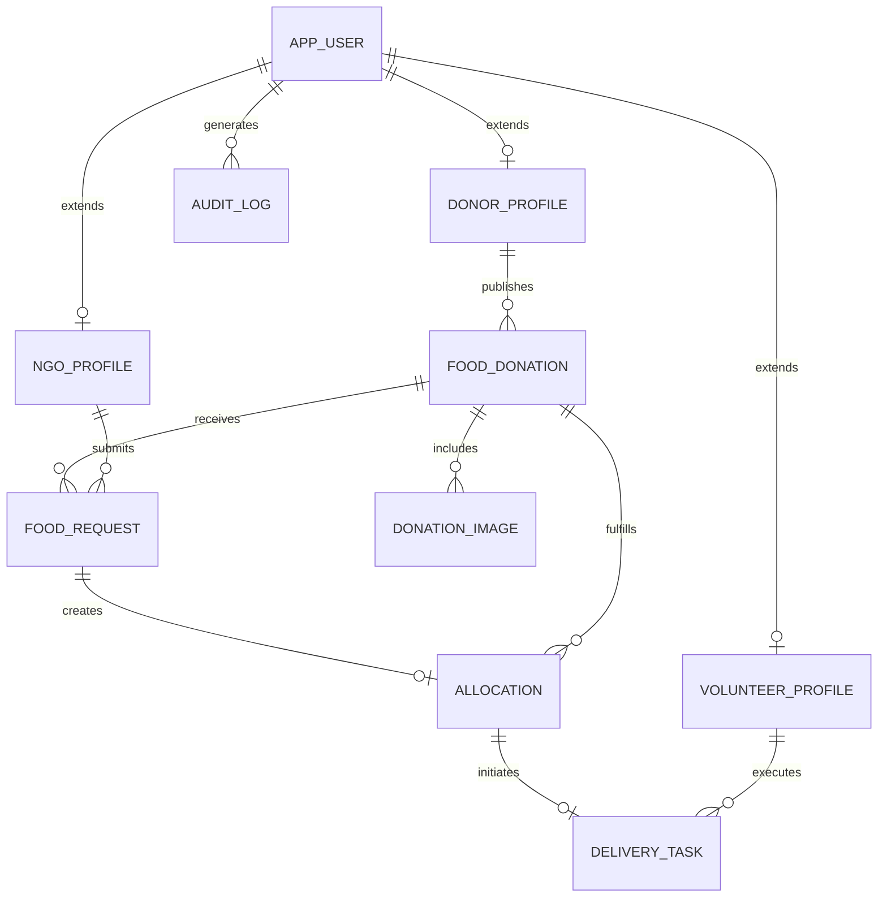

# Database Design & Schema Specification
## REPLATE — Food Waste Donation & Redistribution System
**Database Engine:** PostgreSQL 15+  
**Target Schema:** `public`  
**Naming Conventions:** Snake_case for tables and columns, singular table names (`app_user`, `food_donation`, `allocation`).

---

## 1. Entity-Relationship (ER) Architecture



---

## 2. Table Specifications

### 2.1 `app_user` (Inherited Base Table)
Primary table storing credentials, authentication roles, and contact identity.

| Column | Type | Constraints | Description |
| :--- | :--- | :--- | :--- |
| `id` | `BIGSERIAL` | PRIMARY KEY | Unique surrogate identifier |
| `email` | `VARCHAR(150)` | NOT NULL, UNIQUE | User email address (login credential) |
| `password_hash` | `VARCHAR(255)` | NOT NULL | BCrypt hashed password |
| `phone_number` | `VARCHAR(20)` | NOT NULL | Indian contact number (+91-XXXXX-XXXXX) |
| `full_name` | `VARCHAR(120)` | NOT NULL | Legal individual or institutional contact name |
| `role` | `VARCHAR(30)` | NOT NULL | `DONOR`, `NGO`, `VOLUNTEER`, `ADMIN` |
| `status` | `VARCHAR(30)` | NOT NULL DEFAULT 'ACTIVE' | `PENDING_VERIFICATION`, `ACTIVE`, `SUSPENDED` |
| `address_line1` | `VARCHAR(255)` | NOT NULL | Street / locality |
| `city` | `VARCHAR(80)` | NOT NULL | Indian city (e.g. Bangalore, Delhi NCR, Mumbai) |
| `state` | `VARCHAR(80)` | NOT NULL | Indian state (e.g. Karnataka, Maharashtra) |
| `pincode` | `VARCHAR(10)` | NOT NULL | 6-digit postal code |
| `latitude` | `NUMERIC(10, 7)` | NULLABLE | Geo-coordinate latitude |
| `longitude` | `NUMERIC(10, 7)` | NULLABLE | Geo-coordinate longitude |
| `created_at` | `TIMESTAMP WITH TIME ZONE` | DEFAULT NOW() | Registration timestamp |
| `updated_at` | `TIMESTAMP WITH TIME ZONE` | DEFAULT NOW() | Last modification timestamp |

### 2.2 `donor_profile`
Specialized profile attributes for commercial food institutions.

| Column | Type | Constraints | Description |
| :--- | :--- | :--- | :--- |
| `user_id` | `BIGINT` | PRIMARY KEY, FK(`app_user.id`) | Foreign key linking to parent user |
| `organization_name`| `VARCHAR(150)` | NOT NULL | Business name (*e.g., Saravana Bhavan*) |
| `organization_type`| `VARCHAR(50)` | NOT NULL | `RESTAURANT`, `HOTEL_BANQUET`, `HOSTEL_MESS`, `CATERER` |
| `fssai_license_no` | `VARCHAR(30)` | NOT NULL, UNIQUE | 14-digit FSSAI license number |
| `operating_hours`  | `VARCHAR(100)` | NULLABLE | Typical kitchen wrap-up window |

### 2.3 `ngo_profile`
Verification details and capacity metrics for welfare organizations.

| Column | Type | Constraints | Description |
| :--- | :--- | :--- | :--- |
| `user_id` | `BIGINT` | PRIMARY KEY, FK(`app_user.id`) | Links to base user |
| `ngo_name` | `VARCHAR(150)` | NOT NULL | Registered name (*e.g., Robin Hood Army*) |
| `darpan_id` | `VARCHAR(50)` | NULLABLE | NITI Aayog NGO Darpan unique registration |
| `registration_80g` | `VARCHAR(50)` | NULLABLE | IT Act 80G tax certificate number |
| `daily_beneficiary_capacity` | `INTEGER` | NOT NULL DEFAULT 50 | Daily meal serving capacity |
| `verification_status` | `VARCHAR(30)` | DEFAULT 'PENDING' | `PENDING`, `VERIFIED`, `REJECTED` |

### 2.4 `volunteer_profile`
Details for community logistics partners.

| Column | Type | Constraints | Description |
| :--- | :--- | :--- | :--- |
| `user_id` | `BIGINT` | PRIMARY KEY, FK(`app_user.id`) | Links to base user |
| `vehicle_type` | `VARCHAR(40)` | NOT NULL | `TWO_WHEELER`, `FOUR_WHEELER`, `AUTO_VAN`, `WALK` |
| `emergency_contact` | `VARCHAR(20)` | NOT NULL | Contact phone number |
| `total_deliveries` | `INTEGER` | DEFAULT 0 | Completed volunteer runs |

### 2.5 `food_donation`
Core food listing published by donors.

| Column | Type | Constraints | Description |
| :--- | :--- | :--- | :--- |
| `id` | `BIGSERIAL` | PRIMARY KEY | Unique donation ID |
| `donor_id` | `BIGINT` | NOT NULL, FK(`donor_profile.user_id`) | Donor reference |
| `title` | `VARCHAR(160)` | NOT NULL | Food summary (*e.g., Fresh Dal Makhani & Rotis*) |
| `category` | `VARCHAR(50)` | NOT NULL | `COOKED_MEALS`, `BREADS_ROTIS`, `DAIRY_SWEETS`, `RAW_PRODUCE` |
| `total_quantity` | `NUMERIC(10,2)` | NOT NULL, CHECK(`total_quantity > 0`) | Original posted quantity |
| `available_quantity` | `NUMERIC(10,2)` | NOT NULL, CHECK(`available_quantity >= 0`) | Quantity remaining to allocate |
| `quantity_unit` | `VARCHAR(20)` | NOT NULL | `KG`, `MEAL_BOXES`, `LITERS`, `PORTIONS` |
| `dietary_type` | `VARCHAR(30)` | NOT NULL | `PURE_VEG`, `NON_VEG`, `VEGAN` |
| `storage_condition` | `VARCHAR(40)` | NOT NULL | `HOT_INSULATED`, `REFRIGERATED`, `AMBIENT` |
| `preparation_time` | `TIMESTAMP WITH TIME ZONE` | NOT NULL | When food was cooked/packed |
| `expiry_time` | `TIMESTAMP WITH TIME ZONE` | NOT NULL | Safe consumption threshold |
| `pickup_notes` | `TEXT` | NULLABLE | Packaging, loading gate, or contact person |
| `status` | `VARCHAR(30)` | NOT NULL DEFAULT 'AVAILABLE' | `DRAFT`, `AVAILABLE`, `PARTIALLY_ALLOCATED`, `FULLY_ALLOCATED`, `COMPLETED`, `EXPIRED`, `CANCELLED` |
| `version` | `BIGINT` | NOT NULL DEFAULT 0 | Optimistic locking counter |
| `created_at` | `TIMESTAMP WITH TIME ZONE` | DEFAULT NOW() | Submission timestamp |

### 2.6 `food_request`
Formal requests submitted by NGOs for specific quantities.

| Column | Type | Constraints | Description |
| :--- | :--- | :--- | :--- |
| `id` | `BIGSERIAL` | PRIMARY KEY | Unique request ID |
| `donation_id` | `BIGINT` | NOT NULL, FK(`food_donation.id`) | Target donation |
| `ngo_id` | `BIGINT` | NOT NULL, FK(`ngo_profile.user_id`) | Requesting NGO |
| `requested_quantity` | `NUMERIC(10,2)` | NOT NULL, CHECK(`requested_quantity > 0`) | Quantity requested |
| `intended_beneficiaries`| `TEXT` | NOT NULL | Demographic profile (*e.g., 50 children at shelter*) |
| `status` | `VARCHAR(30)` | NOT NULL DEFAULT 'PENDING' | `PENDING`, `APPROVED`, `REJECTED`, `WITHDRAWN`, `CANCELLED`, `EXPIRED` |
| `rejection_reason` | `VARCHAR(255)` | NULLABLE | Donor justification if declined |
| `created_at` | `TIMESTAMP WITH TIME ZONE` | DEFAULT NOW() | Timestamp |

### 2.7 `allocation`
Finalized claims with deducted inventory.

| Column | Type | Constraints | Description |
| :--- | :--- | :--- | :--- |
| `id` | `BIGSERIAL` | PRIMARY KEY | Unique allocation ID |
| `request_id` | `BIGINT` | NOT NULL, FK(`food_request.id`) | Tied approved food request |
| `donation_id` | `BIGINT` | NOT NULL, FK(`food_donation.id`) | Source food donation batch |
| `allocated_quantity`| `NUMERIC(10,2)` | NOT NULL, CHECK(`allocated_quantity > 0`) | Deducted and committed quantity |
| `status` | `VARCHAR(30)` | NOT NULL DEFAULT 'AWAITING_PICKUP' | `AWAITING_PICKUP`, `IN_TRANSIT`, `DELIVERED`, `CANCELLED` |
| `allocated_by` | `BIGINT` | NULLABLE, FK(`app_user.id`) | Donor or Admin who authorized the allocation |
| `created_at` | `TIMESTAMP WITH TIME ZONE` | DEFAULT CURRENT_TIMESTAMP | Timestamp of allocation |
| `updated_at` | `TIMESTAMP WITH TIME ZONE` | DEFAULT CURRENT_TIMESTAMP | Timestamp of last update |

*Indexes:* `idx_allocation_request (request_id)`, `idx_allocation_donation (donation_id)`.

### 2.8 `delivery_task`
Volunteer logistics and chain-of-custody execution.

| Column | Type | Constraints | Description |
| :--- | :--- | :--- | :--- |
| `id` | `BIGSERIAL` | PRIMARY KEY | Unique task ID |
| `allocation_id` | `BIGINT` | NOT NULL, UNIQUE, FK(`allocation.id`) | Allocation awaiting delivery |
| `volunteer_id` | `BIGINT` | NULLABLE, FK(`volunteer_profile.user_id`) | Assigned driver/volunteer |
| `status` | `VARCHAR(30)` | NOT NULL DEFAULT 'UNASSIGNED' | `UNASSIGNED`, `ASSIGNED`, `PICKED_UP`, `DELIVERED`, `FAILED` |
| `pickup_otp` | `VARCHAR(6)` | NOT NULL | 6-digit verification code |
| `delivery_otp` | `VARCHAR(6)` | NOT NULL | 6-digit delivery confirmation code |
| `picked_up_at` | `TIMESTAMP WITH TIME ZONE` | NULLABLE | Actual timestamp of pickup |
| `delivered_at` | `TIMESTAMP WITH TIME ZONE` | NULLABLE | Actual timestamp of delivery |
| `notes` | `TEXT` | NULLABLE | Special handling notes |

---

## 4. Database Setup & Connectivity Guide

### 4.1 Prerequisites
- PostgreSQL 14+ running locally (e.g. via Homebrew on macOS: `brew services start postgresql@15`).
- Superuser or role matching your local environment (default: `laxyagaba` or standard `postgres`).

### 4.2 Database Initialization
Execute the following commands from the project root:

```bash
# 1. Create database
createdb replate_db

# 2. Run DDL schema
psql -d replate_db -f database/schema.sql

# 3. Seed initial Indian institutions (Saravana Bhavan, Haldiram's, RHA, etc.)
psql -d replate_db -f database/seed-data.sql
```

### 4.3 Environment Configuration (`application.yml`)
The Spring Boot application connects via HikariCP using standard environment variables:

| Environment Variable | Description | Default Fallback |
| :--- | :--- | :--- |
| `DB_HOST` | PostgreSQL host address | `localhost` |
| `DB_PORT` | PostgreSQL TCP port | `5432` |
| `DB_NAME` | Database schema name | `replate_db` |
| `DB_USERNAME` | Database username | `laxyagaba` |
| `DB_PASSWORD` | Database password | *(empty for local trust)* |

### 4.4 Verification
Run the integrated test to verify active connectivity and JPA entity-schema validation:
```bash
cd backend
mvn test -Dtest=ReplateApplicationTests
```


