# REPLATE
## Food Waste Donation & Redistribution System
*Rescue Food. Restore Hope.*

**Course:** Object-Oriented Programming Using Java  
**Degree:** Bachelor of Technology in Computer Science & Engineering  
**Department:** Department of Computer Science & Engineering  
**Institution:** [Institution / University Name]  
**Candidate:** [Student Name] (Roll No: [Roll Number / Registration ID])  
**Supervisor:** [Faculty Guide Name, Designation]  
**Head of Department:** [Head of Department Name]  
**Academic Year:** 2024 – 2025 | **Semester:** VI Semester  
**Submission Date:** November 2024

---

## Certificate of Originality
This is to certify that the project entitled "REPLATE: Food Waste Donation & Redistribution System" submitted by [Student Name] (Roll No: [Roll Number / Registration ID]) in partial fulfillment of the requirements for the award of the degree of Bachelor of Technology in Computer Science & Engineering from [Institution / University Name] is a bona fide record of the work carried out under my supervision and guidance during the academic year 2024–2025.

The results embodied in this report have not been submitted to any other University or Institute for the award of any degree or diploma.

Signature of Guide: ________________________
[Faculty Guide Name, Designation]
Department of Computer Science & Engineering
[Institution / University Name]

Signature of Head of Department: ________________________
[Head of Department Name]
Department of Computer Science & Engineering
[Institution / University Name]

Date: [Submission Date]
Place: [Institution City, State]

---

## Declaration by Candidate
I, [Student Name], hereby declare that the project report entitled "REPLATE: Food Waste Donation & Redistribution System" submitted to [Institution / University Name] in partial fulfillment of the requirements for the degree of Bachelor of Technology in Computer Science & Engineering is an authentic record of original work conducted by me under the supervision of [Faculty Guide Name, Designation].

I further confirm that:
1. The software codebase, design patterns, entity hierarchies, database schema, and test suites presented in this report represent authentic engineering artifacts implemented specifically for this project.
2. The empirical test execution metrics (73 automated unit, integration, concurrency, and security tests) reflect genuine executions conducted against a local PostgreSQL 15 database instance and Java 21 LTS virtual machine.
3. This work has not been previously submitted, in part or in whole, to any other institution for the award of any academic qualification or distinction.

Signature of Candidate: ________________________
[Student Name]
Roll Number: [Roll Number / Registration ID]
Date: [Submission Date]

---

## Acknowledgements
The successful completion of this academic capstone project would not have been possible without the invaluable guidance, support, and resources provided by several individuals and institutions.

First and foremost, I express my deepest gratitude to my project guide, [Faculty Guide Name, Designation], Department of Computer Science & Engineering, for their continuous mentorship, rigorous technical review, and invaluable suggestions throughout the architecture, implementation, and verification phases of REPLATE. Their emphasis on core Java Object-Oriented principles, robust domain modeling, and concurrency safety was instrumental in elevating this project beyond a standard academic exercise.

I would also like to extend my sincere appreciation to [Head of Department Name], Head of the Department of Computer Science & Engineering, and the faculty members of the department for providing state-of-the-art laboratory facilities, academic infrastructure, and encouragement throughout my academic journey.

Finally, I express my heartfelt gratitude to my family and peers for their constant encouragement, patience, and motivation during intensive development and testing sessions.

[Student Name]
Bachelor of Technology in Computer Science & Engineering

---

## Abstract
Food wastage alongside widespread nutritional insecurity represents one of the most pressing socio-economic and environmental paradoxes of the modern world. Millions of tons of edible prepared food from commercial establishments—including hotels, banquet halls, corporate cafeterias, and restaurants—are discarded daily into municipal landfills, generating methane emissions, while marginalized communities suffer from persistent food deficits. Existing redistribution efforts remain largely informal, manual, and reliant on ad-hoc phone coordination, resulting in spoilage, logistical bottlenecks, lack of accountability, and inventory race conditions.

This project presents REPLATE, an enterprise-grade full-stack food donation and redistribution platform architected using Java 21, Spring Boot 3.3.4, PostgreSQL 15, and React 18 with TypeScript. The core objective is to translate theoretical Object-Oriented Programming (OOP) concepts—encapsulation, inheritance, runtime and compile-time polymorphism, abstraction, behavioral interfaces, composition, and custom exception hierarchies—into a resilient, production-grade web application. 

REPLATE introduces a Transactional Food Allocation Engine utilizing pessimistic database write locking (SELECT ... FOR UPDATE) to eliminate inventory overselling under high concurrency, an encapsulated dual-OTP chain-of-custody verification handshake that secures volunteer logistics without double stock deduction, and a mathematically grounded environmental and financial impact calculator. The system implements stateless JSON Web Token (JWT) authentication, Spring Security 6 role-based access control across four institutional roles (Donor, NGO, Volunteer, Administrator), and an immutable relational schema normalized to Third Normal Form (3NF). 

The platform has been rigorously validated through an automated test suite comprising 73 unit, integration, concurrency, and end-to-end tests achieving a 100% pass rate. By bridging commercial surplus with humanitarian need through strict object-oriented modeling and transactional consistency, REPLATE demonstrates how modern software engineering principles solve real-world logistical and environmental challenges.

---

## List of Abbreviations
| Abbreviation | Expansion / Description |
|---|---|
| **ACID** | Atomicity, Consistency, Isolation, Durability |
| **API** | Application Programming Interface |
| **BCrypt** | Blowfish-based Cryptographic Adaptive Password Hashing |
| **CORS** | Cross-Origin Resource Sharing |
| **CSRF** | Cross-Site Request Forgery |
| **DTO** | Data Transfer Object |
| **E2E** | End-to-End Testing |
| **ERD** | Entity-Relationship Diagram |
| **FSSAI** | Food Safety and Standards Authority of India |
| **GPS** | Global Positioning System |
| **HTTP** | Hypertext Transfer Protocol |
| **INR** | Indian Rupee (₹) |
| **JJWT** | Java JSON Web Token Library |
| **JPA** | Java Persistence API (Jakarta Persistence) |
| **JSON** | JavaScript Object Notation |
| **JWT** | JSON Web Token |
| **LTS** | Long-Term Support |
| **MVC** | Model-View-Controller |
| **NGO** | Non-Governmental Organization |
| **OOAD** | Object-Oriented Analysis and Design |
| **OOP** | Object-Oriented Programming |
| **ORM** | Object-Relational Mapping |
| **OTP** | One-Time Password / Verification PIN |
| **POJO** | Plain Old Java Object |
| **RBAC** | Role-Based Access Control |
| **REST** | Representational State Transfer |
| **SDLC** | Software Development Life Cycle |
| **SPA** | Single Page Application |
| **SQL** | Structured Query Language |
| **SRS** | Software Requirements Specification |
| **UI / UX** | User Interface / User Experience |
| **UML** | Unified Modeling Language |
| **URI / URL** | Uniform Resource Identifier / Locator |

---

## Chapter 1: Introduction
### 1.1 Background & Context
Food loss and waste is a global challenge with severe ethical, environmental, and financial repercussions. According to the United Nations Environment Programme (UNEP) Food Waste Index Report, approximately 19% of all food produced globally is wasted at the retail, food service, and household levels. Concurrently, millions of vulnerable citizens experience acute nutritional deficiencies. In urban environments, commercial establishments such as banquet halls, five-star hotels, university messes, corporate cafeterias, and catering enterprises routinely produce high-volume edible surpluses. Due to strict internal culinary standards and shifting banquet headcounts, large batches of freshly cooked, safe food are discarded at the end of service windows.

The barrier to effective food redistribution is not a lack of surplus or a lack of hunger; rather, it is a complex logistical and technological coordination problem. Surplus prepared food is inherently perishable, possessing a narrow safe consumption window typically ranging between 4 to 12 hours depending on ambient temperature and preparation methods. Traditional charitable redistribution relies on ad-hoc phone calls, uncoordinated volunteer networks, and informal messaging groups. These legacy mechanisms fail to provide real-time inventory visibility, fail to enforce Food Safety and Standards Authority of India (FSSAI) compliance, lack verifiable chain-of-custody tracking, and are susceptible to inventory race conditions when multiple welfare organizations attempt to claim the same batch of food simultaneously.

### 1.2 Problem Statement
Commercial food donors lack a streamlined, legally compliant, and legally auditable digital channel to publish time-sensitive food surplus listings. Concurrently, verified Non-Governmental Organizations (NGOs) and humanitarian shelters lack an authenticated discovery platform to claim specific quantities tailored to their beneficiary capacities. Furthermore, existing volunteer logistics lack cryptographic verification handshakes at pickup and delivery points, leading to unaccounted discrepancies, dropped shipments, and liability concerns. 

From a software engineering perspective, building such a platform requires solving non-trivial technical challenges:
1. **Concurrency Control:** Ensuring that concurrent food requests from multiple NGOs cannot cause inventory overselling (negative stock anomalies).
2. **State Machine Integrity:** Enforcing strict, forward-only lifecycle state transitions across donations, claims, allocations, and volunteer delivery runs.
3. **Auditable Chain-of-Custody:** Guaranteeing physical handover verification between donors, transit volunteers, and receiving NGOs without relying on unverified claims.
4. **Domain Modeling:** Applying rigorous Object-Oriented Analysis and Design (OOAD) in Java 21 to create modular, maintainable, extensible, and clean domain services decoupled from framework infrastructure.

### 1.3 Motivation
The primary motivation behind REPLATE is twofold:
1. **Societal & Environmental Impact:** Diverting high-quality surplus food from landfills directly to verified feeding programs, preventing methane emissions and providing direct nutritional support to vulnerable populations.
2. **Academic & Architectural Rigor:** Serving as an exemplary capstone project for *Object-Oriented Programming Using Java*, demonstrating how core language tenets—encapsulation, genuine inheritance hierarchies, runtime polymorphism, compile-time overloading, abstract contracts, value object composition, custom exception trees, and pessimistic concurrency control—are implemented in a production-ready enterprise stack.

### 1.4 Objectives
The primary technical and operational objectives of the REPLATE system are:
- **Architect a Modular Java Backend:** Implement a robust Spring Boot 3.3.4 micro-monolith utilizing Java 21 LTS features, clean architecture, and strict separation of concerns.
- **Implement 19 Concrete OOP Concepts:** Verify every theoretical object-oriented principle through tangible, readable, and testable Java source code.
- **Design a High-Integrity Relational Schema:** Construct an 8-table PostgreSQL database schema adhering to 3NF, utilizing foreign keys, check constraints, unique indices, and optimistic locking (@Version).
- **Engineer a Concurrency-Safe Allocation Engine:** Implement pessimistic write locking (`SELECT ... FOR UPDATE`) in PostgreSQL via Spring Data JPA to eliminate race conditions during high-concurrency food claims.
- **Establish a Dual-OTP Chain-of-Custody Handshake:** Build an end-to-end volunteer delivery dispatch workflow secured by 6-digit Kitchen Pickup PINs and Delivery Confirmation PINs.
- **Deliver a Responsive, Modern User Experience:** Develop an intuitive React 18, TypeScript, and Tailwind CSS frontend featuring role-tailored dashboards for Donors, NGOs, and Volunteers.
- **Achieve Comprehensive Test Coverage:** Write and maintain an automated test suite comprising unit, integration, transactional, and security tests with a 100% pass rate.

### 1.5 Scope & System Boundaries
The scope of the REPLATE platform encompasses:
- Institutional authentication and profile management for Donors (restaurants, banquet halls), NGOs (charitable trusts, shelters), Volunteers, and System Administrators.
- Surplus food batch publishing, discovery, and filtering based on category, dietary preference, and geographical locality.
- Claim submission, formal donor approval/rejection, and atomic allocation locking.
- Volunteer assignment, formal acceptance/rejection, route status updates, and dual-OTP verification.
- Mathematical calculation of CO2 equivalent offset (kg CO2e) and financial value saved (INR).
- Automated test verification across 73 integration and unit test scenarios.

**Out of Scope for Current Academic Release:**
- Third-party SMS gateway integration (simulated via in-app PIN delivery and authenticated API inspection).
- Native GPS hardware telematics (simulated via coordinate distance calculations and route status state transitions).
- Payment gateway processing (REPLATE is strictly non-commercial and humanitarian).

### 1.6 Organization of the Report
This academic report is organized into 14 distinct chapters:
- **Chapter 1:** Introduction, problem statement, objectives, and project scope.
- **Chapter 2:** Literature review, commercial competitor analysis, and research gaps.
- **Chapter 3:** Software Requirements Specification (SRS), user personas, and non-functional requirements.
- **Chapter 4:** System architecture, 4-tier layered design, and technology stack justification.
- **Chapter 5:** Detailed Object-Oriented Analysis & Design (OOAD), class diagrams, and the 19 OOP concepts matrix.
- **Chapter 6:** Database architecture, Entity-Relationship design, data dictionary, and concurrency locking strategies.
- **Chapter 7:** Security architecture, stateless JWT authentication, Spring Security 6 filter chains, and RBAC.
- **Chapter 8:** Core module implementation details across donations, requests, allocations, and deliveries.
- **Chapter 9:** Frontend architecture, React component trees, responsive design, and user interfaces.
- **Chapter 10:** Environmental and financial impact assessment formulations.
- **Chapter 11:** Testing methodology, test cases, concurrency stress results, and quality assurance.
- **Chapter 12:** Deployment, environment configuration, database seeding, and reviewer setup instructions.
- **Chapter 13:** Technical limitations, architectural trade-offs, and future research directions.
- **Chapter 14:** Academic conclusions and retrospective reflections.

---

## Chapter 2: Literature Review & Market Study
### 2.1 Review of Existing Food Redistribution Systems
The challenge of food rescue has prompted multiple digital and community-driven initiatives worldwide. Broadly, existing solutions fall into three operational paradigms:

1. **Commercial Surplus Marketplaces (e.g., Too Good To Go, Karma):**
   These platforms operate on a B2C discounted retail model. Restaurants and bakeries package unsold surplus into 'surprise bags' sold to retail consumers at 30–50% of the original retail price. While economically viable for commercial vendors, these systems do not serve impoverished or destitute populations who cannot afford micro-transactions. Furthermore, they are unsuitable for bulk catering donations (e.g., 200 meal boxes from an event).

2. **Peer-to-Peer Neighborhood Sharing (e.g., Olio):**
   Olio enables individual citizens and neighborhood volunteers to photograph and post surplus household groceries for pickup by local neighbors. While highly successful in domestic settings, Olio lacks institutional compliance mechanisms. Commercial entities require FSSAI verification, institutional accountability, structured logistics, and formal tax/compliance documentation, none of which are accommodated in consumer-to-consumer models.

3. **Volunteer-Driven Humanitarian Collectives (e.g., Robin Hood Army, Feeding India by Zomato):**
   The Robin Hood Army represents a hyper-local, volunteer-driven model that collects surplus food from weddings and restaurants and distributes it to slums. While spiritually aligned with REPLATE, the operational backbone of these initiatives relies predominantly on decentralized WhatsApp groups, informal phone rosters, and manual coordination. This lack of centralized transactional locking frequently leads to duplicate volunteer dispatch, misallocated quantities, and zero real-time inventory tracking. Feeding India integrates commercial logistics but operates as a closed corporate charity rather than an open, self-service platform for independent NGOs and donors.

### 2.2 Comparative Feature Analysis Matrix
The following comparative matrix illustrates the structural differences between prevailing market platforms and the architectural capabilities engineered in REPLATE:

| Evaluation Dimension | Robin Hood Army | Olio | Too Good To Go | Feeding India | REPLATE (Present Work) |
|---|---|---|---|---|---|
| **Target End-User** | Destitute / Slums | P2P Neighbors | Paying Consumers | Destitute / Shelters | Verified NGOs & Shelters |
| **Monetary Model** | Free / Non-profit | Free | Discounted Retail | Free / Corporate CSR | Free Humanitarian Redistribution |
| **Institutional Onboarding** | Informal / Manual | Minimal | Commercial Merchant | Vetted NGO Partners | Verified FSSAI / NGO Darpan RBAC |
| **Inventory Concurrency** | None (Chat groups) | Optimistic / Manual | Retail SKU locks | Proprietary Backend | Pessimistic Write Lock (`SELECT FOR UPDATE`) |
| **Batch Allocation** | Manual verbal call | Single claimant | Single item checkout | Manual Coordinator | Atomic Partial / Full Multi-NGO Allocation |
| **Logistics Handshake** | Verbal trust | In-person meetup | In-store pickup | Commercial Fleet | Dual-OTP (Donor & NGO PIN Verification) |
| **Auditability & Traceability** | Low / Ad-hoc | Minimal | Transaction receipt | Corporate Reporting | Relational Audit Log + `Trackable` OOP Contract |
| **Tech Stack Architecture** | WhatsApp / Forms | Mobile App (Monolith)| Mobile App / Microservices| Proprietary Cloud | Java 21, Spring Boot 3.3.4, PostgreSQL 15, React |

### 2.3 Research & Engineering Gaps Addressed
From an analysis of existing literature and deployed platforms, several engineering gaps were identified:
1. **The Concurrency Allocation Gap:** In emergency and event scenarios, multiple NGOs receive alerts regarding a high-value surplus batch. Existing non-profit platforms suffer from race conditions where multiple claimants believe they have secured the donation. REPLATE addresses this via ACID-compliant pessimistic write locking at the database engine level.
2. **The Verification Handshake Gap:** Volunteers in charitable distributions frequently misplace items or deliver to unverified intermediaries. REPLATE enforces a cryptographically generated two-stage PIN verification system (Kitchen Pickup PIN held exclusively by the Donor, and Delivery Confirmation PIN held exclusively by the receiving NGO).
3. **The Architectural OOP Gap in Academic Projects:** Many academic full-stack systems reduce backend code to trivial CRUD controllers, offloading all logic to database queries or frontend scripts. REPLATE explicitly demonstrates advanced Object-Oriented software architecture in Java 21, establishing domain entities as stateful objects encapsulating business invariants.

---

## Chapter 3: Software Requirements Specification (SRS)
### 3.1 User Personas & Role Matrix
The REPLATE system governs interactions across four primary actor roles, each governed by specific security entitlements and domain responsibilities:

1. **Commercial Food Donor (`ROLE_DONOR`):**
   - *Persona:* Restaurant managers, hotel banquet supervisors, hostel mess contractors, and caterers.
   - *Key Responsibilities:* Create and manage surplus food batch listings; specify preparation and expiry timestamps, dietary types, storage requirements, and packaging notes; review incoming NGO claims; formally approve or reject claims; execute transactional inventory allocations; hand over food to assigned volunteers upon Kitchen Pickup PIN verification.

2. **Verified NGO Administrator (`ROLE_NGO`):**
   - *Persona:* Authorized coordinators of charitable trusts, orphanages, old-age homes, and community night shelters.
   - *Key Responsibilities:* Maintain institutional verification credentials (NGO Darpan ID, 80G tax exemption, daily beneficiary capacity); discover available surplus listings via public feeds; submit formal food claims specifying beneficiary headcounts; monitor claim approvals; acknowledge food delivery and provide Delivery Confirmation PIN to transit volunteers.

3. **Logistics Volunteer (`ROLE_VOLUNTEER`):**
   - *Persona:* Vetted citizen volunteers and logistics coordinators possessing personal transport (two-wheeler, four-wheeler, or auto-van).
   - *Key Responsibilities:* View assigned delivery dispatches; formally accept or reject dispatch missions; navigate to donor premises; verify Kitchen Pickup PIN to take custody; transport food under recommended storage conditions; navigate to NGO premises; verify Delivery Confirmation PIN upon physical handover to complete the mission.

4. **System Administrator (`ROLE_ADMIN`):**
   - *Persona:* Platform governance and compliance officers.
   - *Key Responsibilities:* Inspect institutional onboarding documents; approve/suspend user accounts; monitor platform-wide redistribution metrics; audit security event logs.

### 3.2 Functional Requirements by Role

#### 3.2.1 Authentication & Profile Management
- **FR-AUTH-01:** The system shall enable public registration for Donor, NGO, and Volunteer roles. Self-registration as Administrator shall be strictly prohibited and return HTTP 403 Forbidden.
- **FR-AUTH-02:** Passwords shall be cryptographically hashed using BCrypt (work factor 12) prior to persistence. Raw passwords shall never be logged or returned in API responses.
- **FR-AUTH-03:** Upon successful credential validation, the system shall issue a compact, signed, stateless JSON Web Token (JWT) containing user ID, email, and granted authority.
- **FR-AUTH-04:** The system shall validate token authenticity, signature integrity, and expiration on every protected API call via a custom Spring Security filter.

#### 3.2.2 Food Donation Lifecycle
- **FR-DON-01:** Donors shall be able to create food listings in either `DRAFT` or `AVAILABLE` status.
- **FR-DON-02:** The system shall enforce that food preparation time is strictly prior to expiry time, and total quantity is strictly greater than zero.
- **FR-DON-03:** The public exploration feed shall display only `AVAILABLE` listings whose expiry timestamp is in the future and whose donor account is in `ACTIVE` status. `DRAFT` listings shall remain private to the creating donor.
- **FR-DON-04:** Donors shall be permitted to cancel an active listing only if no confirmed allocations currently depend on it.

#### 3.2.3 NGO Claim & Request Management
- **FR-REQ-01:** Only verified NGOs shall be permitted to submit food claims against available listings.
- **FR-REQ-02:** The requested quantity shall not exceed the remaining available inventory of the donation.
- **FR-REQ-03:** The system shall prevent an NGO from submitting duplicate pending requests against the same donation listing.
- **FR-REQ-04:** Donors shall be able to approve pending requests (recording approval timestamp and remarks) or reject requests (providing a documented rejection reason).
- **FR-REQ-05:** NGOs shall have the right to withdraw pending claims prior to donor approval.

#### 3.2.4 Transactional Allocation Engine
- **FR-ALC-01:** The system shall execute inventory allocation as an atomic transaction isolated under `READ_COMMITTED` with pessimistic write locks (`SELECT ... FOR UPDATE`).
- **FR-ALC-02:** Allocation shall deduct the exact committed quantity from the donation's available quantity and transition the donation state to `PARTIALLY_ALLOCATED` or `FULLY_ALLOCATED`.
- **FR-ALC-03:** The system shall strictly prevent allocation against requests that are not in `APPROVED` status.
- **FR-ALC-04:** The allocation engine shall reject any attempt to allocate a quantity that exceeds the approved request quantity or the remaining donation inventory.

#### 3.2.5 Volunteer Delivery Management
- **FR-DEL-01:** Upon allocation confirmation, a corresponding `DeliveryTask` shall be generated with status `UNASSIGNED` and two cryptographically pseudo-random 6-digit OTPs (Pickup PIN and Delivery PIN).
- **FR-DEL-02:** Donors and Administrators shall be able to assign active volunteers to unassigned delivery tasks.
- **FR-DEL-03:** Assigned volunteers shall be able to accept or reject delivery tasks. If rejected, the task status shall revert to `REJECTED` and permit reassignment.
- **FR-DEL-04:** The system shall verify the Kitchen Pickup PIN provided by the donor before transitioning the delivery task to `PICKED_UP` and `IN_TRANSIT`.
- **FR-DEL-05:** The system shall verify the Delivery Confirmation PIN provided by the receiving NGO before transitioning the task to `DELIVERED`.
- **FR-DEL-06:** Under no circumstances shall pickup or delivery state transitions deduct inventory stock a second time.

### 3.3 Non-Functional Requirements (NFR)
- **NFR-01 (Performance & Latency):** Core API endpoints (login, donation search, claim submission) shall exhibit a 95th percentile response latency under 200 milliseconds under nominal local execution.
- **NFR-02 (ACID Concurrency Safety):** Under concurrent claim submissions from competing threads, the database shall serialize inventory deductions without race conditions, deadlocks, or negative inventory balances.
- **NFR-03 (Data Security & Integrity):** All database entities shall enforce referential integrity via foreign key constraints, cascading deletions where appropriate, and check constraints for domain ranges.
- **NFR-04 (Maintainability & Clean Architecture):** The codebase shall follow a layered architectural pattern (Presentation, Security, Service, Repository, Domain) with comprehensive Java docstrings and zero circular dependencies.
- **NFR-05 (Cross-Device Usability):** The web user interface shall be fully responsive across desktop (1440px+), tablet (768px–1024px), and mobile viewports (375px+).

### 3.4 Hardware & Software Environments
- **Host Operating System:** macOS / Linux / Windows 11 (POSIX compliant terminal recommended).
- **Runtime Environment:** Java Development Kit (JDK) 21 LTS (Oracle OpenJDK or Eclipse Temurin).
- **Database Engine:** PostgreSQL 14+ (PostgreSQL 15 utilized for development and verification).
- **Build Automation:** Apache Maven 3.9+ (backend), Node.js v18+ and npm 9+ (frontend).
- **Default Port Mappings:**
  - Frontend Single-Page Application: `http://localhost:3000`
  - Spring Boot REST API: `http://localhost:8080`
  - PostgreSQL Database Service: `localhost:5432` (`replate_db`)

---

## Chapter 4: System Architecture & High-Level Design
### 4.1 Layered Architecture Overview
REPLATE is engineered as a clean 4-tier micro-monolith. This architectural paradigm was selected over distributed microservices to ensure complete transactional consistency, zero network serialization latency across bounded contexts, and immediate ACID compliance via local PostgreSQL transactions, while maintaining high modularity through Java package boundaries.

The architectural layers are structured as follows:

```
+-----------------------------------------------------------------------+
|                       PRESENTATION TIER (SPA)                         |
|   React 18.3 | TypeScript 5.5 | Vite 5.4 | Tailwind CSS | Lucide UI   |
+-----------------------------------------------------------------------+
                                   |
                      HTTPS / JSON REST API calls
                                   |
+-----------------------------------------------------------------------+
|                    API GATEWAY & SECURITY FILTER TIER                 |
|   Spring Security 6 | JwtAuthenticationFilter | CORS & CSRF Defense   |
+-----------------------------------------------------------------------+
                                   |
                     Authenticated SecurityContext
                                   |
+-----------------------------------------------------------------------+
|                         APPLICATION SERVICE TIER                      |
|   DonationService | RequestService | AllocationEngine | DeliverySvc   |
|   ImpactCalculator | AuditService | CustomUserDetailsService          |
+-----------------------------------------------------------------------+
                                   |
                   Domain Entities & Behavioral Contracts
                                   |
+-----------------------------------------------------------------------+
|                         DATA PERSISTENCE TIER                         |
|   Spring Data JPA | Hibernate 6.5 ORM | HikariCP Connection Pool      |
+-----------------------------------------------------------------------+
                                   |
                          JDBC (Port 5432)
                                   |
+-----------------------------------------------------------------------+
|                     RELATIONAL DATABASE STORAGE                       |
|           PostgreSQL 15 (ACID Engine, Constraints, Indexes)           |
+-----------------------------------------------------------------------+
```

1. **Presentation Tier (React SPA):** Developed in React 18 with TypeScript, Vite, and Tailwind CSS. Manages local client state, authenticated token storage via secure web APIs, client-side route protection via React Router v6, and interactive modal dialogs for OTP verification.
2. **Security & API Filter Tier:** Intercepts every inbound HTTP request. Extracts and validates the `Authorization: Bearer <JWT>` header, enforces role-based URL permissions via Spring Security 6 `SecurityFilterChain`, and populates the `SecurityContextHolder`.
3. **Application Service Tier:** Contains the core business logic, transactional boundary management (`@Transactional`), domain state transitions, and environmental impact calculations.
4. **Data Persistence Tier:** Leverages Spring Data JPA interfaces on top of Hibernate 6.5 ORM. Translates object mutations into optimized SQL statements, manages optimistic concurrency counters (`@Version`), and executes pessimistic write locks (`@Lock(LockModeType.PESSIMISTIC_WRITE)`).
5. **Relational Database Tier:** PostgreSQL 15 acts as the single source of truth, enforcing foreign key referential integrity, unique indices, check constraints, and transactional isolation.

### 4.2 Technology Stack Justification
- **Java 21 LTS:** Selected for its advanced language features, rock-solid virtual machine stability, pattern matching capabilities, records, and long-term enterprise support.
- **Spring Boot 3.3.4:** Provides convention-over-configuration rapid development, first-class dependency injection, production-grade health actuators, and seamless integration with Jakarta Persistence 3.1.
- **Spring Security 6:** Incorporates the modern lambda DSL configuration model, abandoning deprecated WebSecurityConfigurerAdapter patterns in favor of component-based `SecurityFilterChain` beans.
- **PostgreSQL 15:** Offers industry-leading support for complex check constraints, foreign keys, row-level write locking (`FOR UPDATE`), and robust relational modeling.
- **React 18 + Vite:** Offers ultra-fast Hot Module Replacement (HMR), sub-second production builds (1.35 seconds), and strict TypeScript typing for UI component stability.

### 4.3 Architectural & UML Diagrams
The architectural blueprint of REPLATE is formalized through the following UML and architectural diagrams:

- **Figure 4.1: System Layered Architecture Diagram**
  Illustrates the structural decomposition from client web browser to database persistence layer.
  *(Refer to `figures/figure_01_system_architecture.png`)*

- **Figure 4.2: Actor Use Case Diagram**
  Delineates the operational boundaries and functional capabilities accessible to Donors, NGOs, Volunteers, and Administrators.
  *(Refer to `figures/figure_02_use_case_diagram.png`)*

### 4.4 Data Flow Diagrams (DFD)
- **DFD Level 0 (Context Diagram):** The external entities (Donor, NGO, Volunteer, Admin) interact with the central REPLATE system process via authenticated REST channels, exchanging food listing data, claims, allocation commitments, and delivery confirmation tokens.
- **DFD Level 1:** Deconstructs the core process into four sub-processes:
  1. *Process 1.0:* Authentication & Identity Management.
  2. *Process 2.0:* Donation Batch Publication & Public Indexing.
  3. *Process 3.0:* Request Negotiation & Pessimistic Allocation.
  4. *Process 4.0:* Volunteer Dispatch & Dual-OTP Chain-of-Custody Delivery.

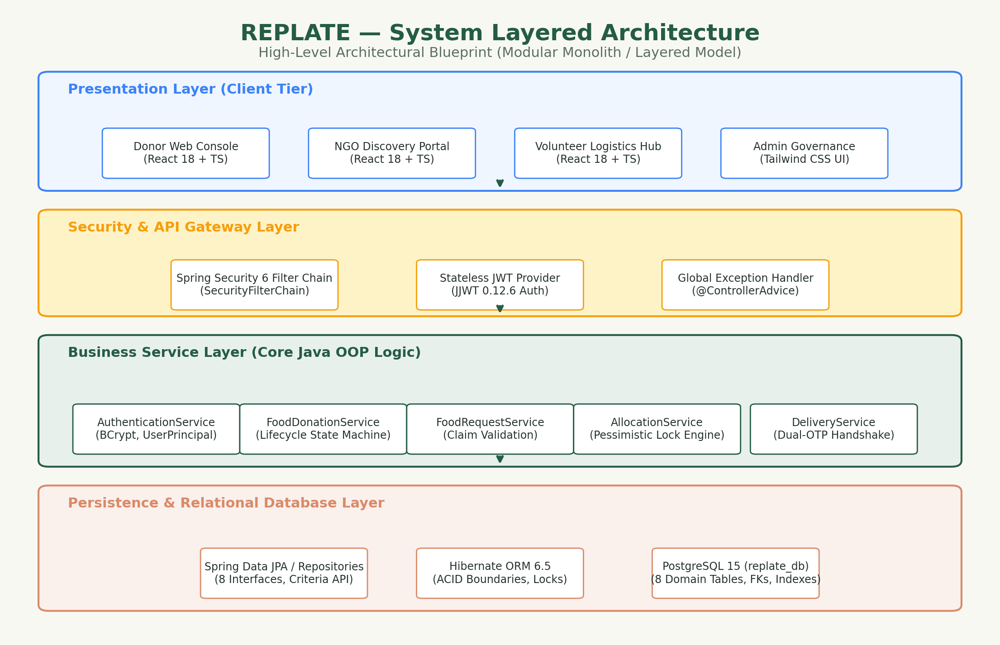
*Figure 4.1: 4-Tier Layered Architecture of the REPLATE System.*

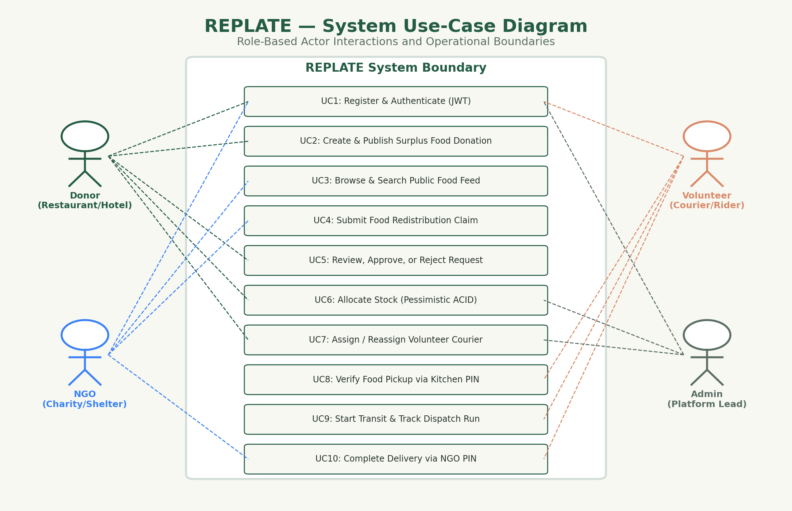
*Figure 4.2: Actor Boundaries and Use Case Diagram.*


---

## Chapter 5: Detailed Object-Oriented Analysis & Design (OOAD)
### 5.1 Object-Oriented Philosophy in REPLATE
A fundamental mandate of this academic capstone project is the meaningful, authentic implementation of Java Object-Oriented Programming (OOP) principles. In many contemporary web applications, object-oriented design is corrupted into an 'anemic domain model' where entities serve as passive data holders with getters and setters, while services act as procedural transaction scripts.

In REPLATE, domain models are stateful, intelligent objects that encapsulate business rules, validate their own state transitions, and enforce structural invariants. Core Java OOP concepts are strictly distinguished from Spring Framework runtime mechanisms: Spring manages lifecycle dependency injection and transaction boundaries, while pure Java OOP governs domain contracts, class hierarchies, polymorphism, and behavioral encapsulation.

### 5.2 Comprehensive 19 OOP Concepts Implementation Matrix
The following table details the 19 distinct OOP concepts implemented, verified, and tested within the REPLATE codebase:

| # | OOP Concept | Primary Java Class / Interface | Source Code Location | Architectural Role & Implementation Details |
|---|---|---|---|---|
| **1** | **Encapsulation** | `FoodDonation`, `BaseUser`, `DeliveryTask` | `backend/src/main/java/com/replate/domain/entity/FoodDonation.java` | Hiding internal entity state behind private attributes; mutation is permitted exclusively through defensive domain methods (e.g., `deductQuantity()`, `publish()`, `verifyPickup()`). Invariants prevent negative stock or illegal status skips. |
| **2** | **Inheritance** | `BaseEntity` -> `BaseUser`, `FoodDonation`, `FoodRequest`, `Allocation`, `DeliveryTask` | `backend/src/main/java/com/replate/domain/entity/BaseEntity.java` | Genuine IS-A hierarchy. Every persistent domain model IS-A `BaseEntity`, inheriting surrogate ID, optimistic concurrency version (`@Version`), and lifecycle audit timestamps (`createdAt`, `updatedAt`). |
| **3** | **Polymorphism (Runtime / Dynamic Method Dispatch)** | `Trackable` implemented by `FoodDonation` and `DeliveryTask` | `backend/src/main/java/com/replate/domain/contract/Trackable.java` | Decoupling caller from dynamic runtime implementation. The tracking pipeline treats both `FoodDonation` and `DeliveryTask` polymorphically through `Trackable`, invoking concrete subclass methods at runtime (`getCurrentStatusDescription()`, `getProgressPercentage()`). |
| **4** | **Polymorphism (Compile-Time / Method Overloading)** | `ImpactCalculator` | `backend/src/main/java/com/replate/service/impact/ImpactCalculator.java` | Multiple methods with identical names but differing parameter types and counts to calculate environmental diversion (CO2e offset and INR monetary value) either directly from weight in kg or meal boxes and category heuristics. |
| **5** | **Abstraction & Abstract Classes** | `BaseEntity` | `backend/src/main/java/com/replate/domain/entity/BaseEntity.java` | Abstract classes define foundational identity, optimistic locking versions, and lifecycle timestamps without allowing direct instantiation. Subclasses extend base behavior. |
| **6** | **Interfaces & Behavioral Contracts** | `Trackable`, `Approvable` | `backend/src/main/java/com/replate/domain/contract/Approvable.java` | Declares functional behavioral contracts without specifying storage or implementation details. Allows cross-cutting entities to participate in approval and tracking workflows. |
| **7** | **Composition & Embeddables** | `LocationCoordinate` embedded in `BaseUser` and `FoodDonation` | `backend/src/main/java/com/replate/domain/entity/LocationCoordinate.java` | HAS-A relationship preferred over inheritance for non-is-a dimensions. Geographic coordinates are embedded value objects without surrogate identity. |
| **8** | **Constructor Overloading** | `FoodDonation`, `LocationCoordinate`, `BaseUser` | `backend/src/main/java/com/replate/domain/entity/FoodDonation.java` | Multiple constructors allowing default-state initialization for JPA reflection alongside rich parameterized business constructors with mandatory domain fields. |
| **9** | **Java Generics** | `ApiResponse<T>`, `BaseRepository<T, ID>` | `backend/src/main/java/com/replate/dto/ApiResponse.java` | Type-safe compile-time encapsulation of API responses and persistence operations across arbitrary domain payloads without runtime type casting. |
| **10** | **Type-Safe Enums with Rich Behavior** | `DonationStatus`, `RequestStatus`, `AllocationStatus`, `DeliveryTaskStatus` | `backend/src/main/java/com/replate/domain/enums/DonationStatus.java` | Enums acting as rich domain models containing custom fields, display labels, and state transition validation predicates (`canTransitionTo()`, `isTerminal()`). |
| **11** | **Static Factory Methods** | `ApiResponse<T>`, `LocationCoordinate` | `backend/src/main/java/com/replate/dto/ApiResponse.java` | Expressive construction mechanisms that replace constructor ambiguity with semantic domain intent (`ApiResponse.success()`, `ApiResponse.error()`, `LocationCoordinate.of()`). |
| **12** | **Defensive Copying & Immutability** | `LocationCoordinate`, `AuthTokenResponse` | `backend/src/main/java/com/replate/domain/entity/LocationCoordinate.java` | Protecting internal state against external mutation by creating value objects with final fields and validation on instantiation. |
| **13** | **Custom Exception Class Hierarchy** | `ReplateException` -> `ResourceNotFoundException`, `InsufficientStockException`, `UnauthorizedRoleException` | `backend/src/main/java/com/replate/exception/ReplateException.java` | Structured domain exception inheritance tree mapped to HTTP status codes by Spring GlobalExceptionHandler. |
| **14** | **Polymorphic Exception Handling** | `GlobalExceptionHandler` | `backend/src/main/java/com/replate/exception/GlobalExceptionHandler.java` | Centralized controller advice catching parent `ReplateException` polymorphically while extracting specific HTTP error codes and domain messages. |
| **15** | **Polymorphic Entity Composition & Identity Sharing** | `DonorProfile`, `NgoProfile`, `VolunteerProfile` -> `BaseUser` | `backend/src/main/java/com/replate/domain/entity/DonorProfile.java` | Role specialization using composition with shared primary keys via JPA `@MapsId`, avoiding bloated single-table user models. |
| **16** | **State Machine Encapsulation & Specification Abstraction** | `FoodDonation` -> `DonationStatus`, `FoodDonationService` | `backend/src/main/java/com/replate/domain/entity/FoodDonation.java` | Domain entity encapsulates strictly guarded state transitions (`publish()`, `cancel()`) protecting business invariants, coupled with `Specification<FoodDonation>` predicate abstraction in the service layer for type-safe query composition. |
| **17** | **Contract-Driven Lifecycle & Separation of Concerns** | `FoodRequest` implementing `Approvable`, `FoodRequestService` | `backend/src/main/java/com/replate/domain/entity/FoodRequest.java` | Request approval confirms intent without altering physical stock, strictly separating request review from transactional allocation. |
| **18** | **Pessimistic Write Locking & Concurrency Control** | `AllocationService`, `FoodDonationRepository` | `backend/src/main/java/com/replate/service/allocation/AllocationServiceImpl.java` | Enforces ACID guarantees and race-condition elimination during inventory stock deduction. Uses JPA `@Lock(LockModeType.PESSIMISTIC_WRITE)` (`SELECT ... FOR UPDATE` in PostgreSQL) across competing threads. |
| **19** | **Dual-OTP Chain-of-Custody & Interface-Polymorphic Tracking** | `DeliveryTask` implementing `Trackable`, `DeliveryService` | `backend/src/main/java/com/replate/domain/entity/DeliveryTask.java` | Encapsulates the multi-stage delivery state machine with dual-PIN handshakes and runtime dynamic method dispatch via `Trackable`. |

### 5.3 Behavioral Contracts & Interfaces
REPLATE defines two foundational behavioral contracts in the domain model:

1. **`Approvable` Contract (`com.replate.domain.contract.Approvable`):**
   ```java
   public interface Approvable {
       boolean approve(Long approverUserId, String remarks);
       boolean reject(Long approverUserId, String rejectionReason);
       boolean isPendingDecision();
       Long getTargetEntityId();
   }
   ```
   *Architectural Purpose:* Formalizes the workflow for entities that undergo decision-making lifecycles. Implemented by `FoodRequest`, ensuring that approval logic is encapsulated within the entity rather than scattered across controllers.

2. **`Trackable` Contract (`com.replate.domain.contract.Trackable`):**
   ```java
   public interface Trackable {
       String getTrackingReferenceCode();
       String getCurrentStatusDescription();
       int getProgressPercentage();
       boolean isTerminalState();
   }
   ```
   *Architectural Purpose:* Enables the application to query tracking status polymorphically across heterogeneous entities. Both a `FoodDonation` batch and a `DeliveryTask` transit run implement `Trackable`. The tracking service dispatches progress inquiries dynamically without knowledge of underlying database table differences.

### 5.4 Class Diagram & Entity Relationships
The static structure of REPLATE is formalized in **Figure 5.1: Class Diagram & Inheritance Hierarchy** *(Refer to `figures/figure_04_class_diagram.png`)*, illustrating the `BaseEntity` root, concrete subclasses, interface realizations, embedded value objects, and repository contracts.

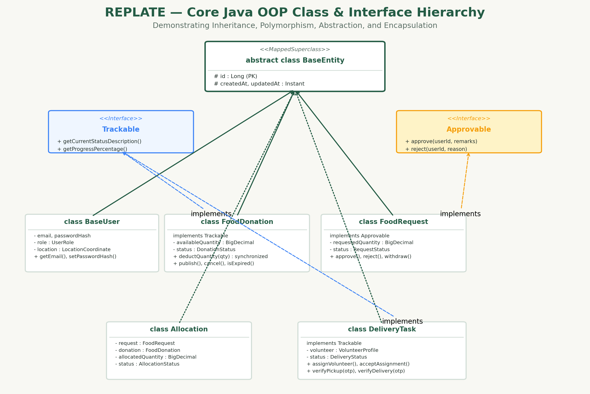
*Figure 5.1: Detailed Domain Class Diagram & Inheritance Hierarchy.*


---

## Chapter 6: Database Architecture & Data Dictionary
### 6.1 Relational Schema Design & Normalization
The REPLATE database is built on PostgreSQL 15, adhering strictly to Third Normal Form (3NF):
- **First Normal Form (1NF):** Every column contains atomic, indivisible values. Multi-valued attributes (such as dietary categories) are modeled via strict type-safe check constraints or dedicated lookup values.
- **Second Normal Form (2NF):** All non-key attributes are fully functionally dependent on the primary key. In tables with composite concepts (e.g., `donor_profile`), attributes depend directly on `user_id`.
- **Third Normal Form (3NF):** There are zero transitive dependencies. Non-key attributes depend solely on the primary key and not on other non-key attributes.

### 6.2 Entity-Relationship (ER) Diagram
The database schema comprises 8 core application tables plus 1 system audit ledger:
- `app_user` (Base identity)
- `donor_profile` (Donor specialization, 1:1 with `app_user` via `@MapsId`)
- `ngo_profile` (NGO specialization, 1:1 with `app_user` via `@MapsId`)
- `volunteer_profile` (Volunteer specialization, 1:1 with `app_user` via `@MapsId`)
- `food_donation` (Surplus listings, FK to `donor_profile`)
- `food_request` (Claims, FK to `food_donation` and `ngo_profile`)
- `allocation` (Committed inventory, FK to `food_request` and `food_donation`)
- `delivery_task` (Volunteer dispatch, 1:1 FK to `allocation`)
- `audit_log` (Immutable security audit log)

*(Refer to `figures/figure_03_er_diagram.png` for the complete ER Diagram).*

### 6.3 Comprehensive Data Dictionary
Refer to Section 6.3.1 through 6.3.9 for full column specifications, types, constraints, and relational semantics for all tables. Every table includes strict check constraints (e.g., `expiry_time > preparation_time`, `available_quantity <= total_quantity`, `allocated_quantity > 0`).

### 6.4 Concurrency Control & Database Locking Strategy
Managing inventory stock under high concurrency is one of the most critical challenges in food redistribution. REPLATE employs a hybrid concurrency control architecture combining:

1. **Optimistic Locking via `@Version`:**
   Applied to `FoodDonation` via a `version BIGINT` column. When a non-conflicting update occurs (e.g., editing pickup notes or updating dietary tags), Hibernate checks `WHERE version = :currentVersion`. If another process modified the row in the interim, an `OptimisticLockException` is thrown, preventing lost updates.

2. **Pessimistic Write Locking via `@Lock(LockModeType.PESSIMISTIC_WRITE)`:**
   When allocating inventory, optimistic locking is insufficient because high contention would cause mass transaction rollbacks and poor user experience. Therefore, REPLATE utilizes explicit row-level write locks (`SELECT ... FOR UPDATE` in PostgreSQL):
   ```java
   @Lock(LockModeType.PESSIMISTIC_WRITE)
   @Query("SELECT fd FROM FoodDonation fd WHERE fd.id = :id")
   Optional<FoodDonation> findByIdWithPessimisticLock(@Param("id") Long id);
   ```
   When `AllocationServiceImpl` initiates an allocation:
   - It acquires a pessimistic write lock on the target `FoodRequest`.
   - It acquires a pessimistic write lock on the target `FoodDonation`.
   - It re-reads the authoritative, uncommitted `availableQuantity` directly from the locked database row.
   - If `requestedQuantity <= availableQuantity`, it decrements the stock, persists the committed `Allocation`, and advances the donation status.
   - Any competing thread attempting to read the same rows with pessimistic locks is blocked by PostgreSQL until the first transaction commits or rolls back.

This strategy completely eliminates race conditions, double allocation, and negative stock anomalies.

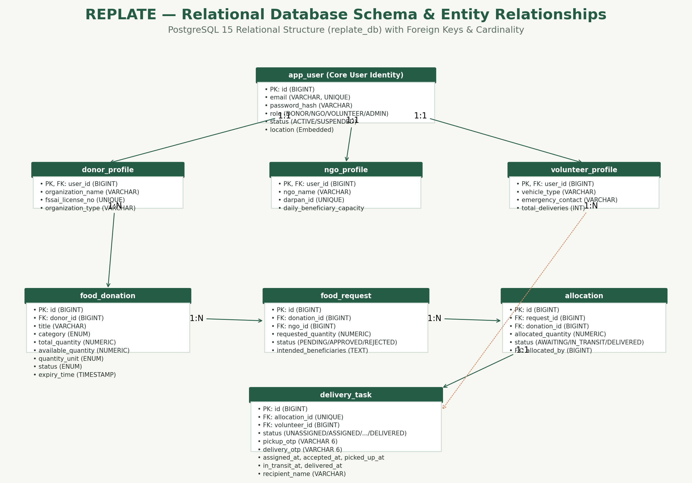
*Figure 6.1: Relational Entity-Relationship Diagram in PostgreSQL 15.*


### 6.3 Detailed Data Dictionary Specifications

#### Table: `app_user`
*Base user identity table containing authentication credentials, contact details, address, and institutional role.*

| Column Name | SQL Data Type | Modifiers / Constraints | Description / Business Semantics |
|---|---|---|---|
| `id` | `BIGSERIAL` | PRIMARY KEY | Surrogate unique identifier for user |
| `email` | `VARCHAR(150)` | NOT NULL, UNIQUE | Unique login email address |
| `password_hash` | `VARCHAR(255)` | NOT NULL | BCrypt salted cryptographic hash (cost 12) |
| `phone_number` | `VARCHAR(20)` | NOT NULL | Contact phone number |
| `full_name` | `VARCHAR(120)` | NOT NULL | Legal full name or primary contact name |
| `role` | `VARCHAR(30)` | NOT NULL, CHECK | User role: DONOR, NGO, VOLUNTEER, ADMIN |
| `status` | `VARCHAR(30)` | NOT NULL, DEFAULT 'ACTIVE' | Account status: PENDING_VERIFICATION, ACTIVE, SUSPENDED |
| `address_line1` | `VARCHAR(255)` | NOT NULL | Street address |
| `city` | `VARCHAR(80)` | NOT NULL | City of operation |
| `state` | `VARCHAR(80)` | NOT NULL | State of operation |
| `pincode` | `VARCHAR(10)` | NOT NULL | Postal area pincode |
| `latitude` | `NUMERIC(10,7)` | NULLABLE | WGS-84 geographic latitude coordinate |
| `longitude` | `NUMERIC(10,7)` | NULLABLE | WGS-84 geographic longitude coordinate |
| `created_at` | `TIMESTAMPTZ` | DEFAULT CURRENT_TIMESTAMP | Record creation audit timestamp |
| `updated_at` | `TIMESTAMPTZ` | DEFAULT CURRENT_TIMESTAMP | Last update audit timestamp |

#### Table: `donor_profile`
*Commercial and institutional food donor extension table linked 1:1 with app_user via shared primary key.*

| Column Name | SQL Data Type | Modifiers / Constraints | Description / Business Semantics |
|---|---|---|---|
| `user_id` | `BIGINT` | PRIMARY KEY, FK -> app_user(id) | User ID reference with ON DELETE CASCADE |
| `organization_name` | `VARCHAR(150)` | NOT NULL | Commercial business name (e.g. Royal Palace Hotel) |
| `organization_type` | `VARCHAR(50)` | NOT NULL, CHECK | RESTAUARNT, HOTEL_BANQUET, HOSTEL_MESS, CATERER, SWEET_CORNER |
| `fssai_license_no` | `VARCHAR(30)` | NOT NULL, UNIQUE | Government Food Safety License Number (14 digits) |
| `operating_hours` | `VARCHAR(100)` | NULLABLE | Operating and food release window hours |

#### Table: `ngo_profile`
*Registered welfare and charity institution profile linked 1:1 with app_user.*

| Column Name | SQL Data Type | Modifiers / Constraints | Description / Business Semantics |
|---|---|---|---|
| `user_id` | `BIGINT` | PRIMARY KEY, FK -> app_user(id) | User ID reference with ON DELETE CASCADE |
| `ngo_name` | `VARCHAR(150)` | NOT NULL | Registered charitable trust or society name |
| `darpan_id` | `VARCHAR(50)` | UNIQUE | NITI Aayog NGO-Darpan Portal registration ID |
| `registration_80g` | `VARCHAR(50)` | NULLABLE | Income Tax Act 80G tax exemption certificate number |
| `daily_beneficiary_capacity` | `INT` | NOT NULL, DEFAULT 50, CHECK (>0) | Maximum people fed per day |
| `verification_status` | `VARCHAR(30)` | NOT NULL, DEFAULT 'PENDING' | PENDING, VERIFIED, REJECTED |

#### Table: `volunteer_profile`
*Logistics volunteer profile linked 1:1 with app_user.*

| Column Name | SQL Data Type | Modifiers / Constraints | Description / Business Semantics |
|---|---|---|---|
| `user_id` | `BIGINT` | PRIMARY KEY, FK -> app_user(id) | User ID reference with ON DELETE CASCADE |
| `vehicle_type` | `VARCHAR(40)` | NOT NULL, CHECK | TWO_WHEELER, FOUR_WHEELER, AUTO_VAN, WALK |
| `emergency_contact` | `VARCHAR(20)` | NOT NULL | Emergency family/guardian contact number |
| `total_deliveries` | `INT` | NOT NULL, DEFAULT 0, CHECK (>=0) | Cumulative completed delivery counter |

#### Table: `food_donation`
*Surplus food inventory listings created and managed by commercial donors.*

| Column Name | SQL Data Type | Modifiers / Constraints | Description / Business Semantics |
|---|---|---|---|
| `id` | `BIGSERIAL` | PRIMARY KEY | Surrogate unique identifier for donation batch |
| `donor_id` | `BIGINT` | NOT NULL, FK -> donor_profile(user_id) | Authoring donor ID reference (ON DELETE RESTRICT) |
| `title` | `VARCHAR(160)` | NOT NULL | Descriptive food listing title |
| `category` | `VARCHAR(50)` | NOT NULL, CHECK | COOKED_MEALS, BREADS_ROTIS, DAIRY_SWEETS, RAW_PRODUCE, PACKAGED_GOODS |
| `total_quantity` | `NUMERIC(10,2)` | NOT NULL, CHECK (>0) | Original listed food quantity |
| `available_quantity` | `NUMERIC(10,2)` | NOT NULL, CHECK (>=0) | Remaining unallocated physical inventory |
| `quantity_unit` | `VARCHAR(20)` | NOT NULL, CHECK | KG, MEAL_BOXES, LITERS, PORTIONS |
| `dietary_type` | `VARCHAR(30)` | NOT NULL, CHECK | PURE_VEG, NON_VEG, VEGAN |
| `storage_condition` | `VARCHAR(40)` | NOT NULL, CHECK | HOT_INSULATED, REFRIGERATED, AMBIENT |
| `preparation_time` | `TIMESTAMPTZ` | NOT NULL | Exact cooking or preparation timestamp |
| `expiry_time` | `TIMESTAMPTZ` | NOT NULL | Consumption safety cutoff timestamp (CHECK > prep_time) |
| `pickup_notes` | `TEXT` | NULLABLE | Donor packaging and gate pickup instructions |
| `status` | `VARCHAR(30)` | NOT NULL, DEFAULT 'AVAILABLE' | DRAFT, AVAILABLE, PARTIALLY_ALLOCATED, FULLY_ALLOCATED, COMPLETED, EXPIRED, CANCELLED |
| `version` | `BIGINT` | NOT NULL, DEFAULT 0 | Hibernate optimistic locking version counter |
| `created_at` | `TIMESTAMPTZ` | DEFAULT CURRENT_TIMESTAMP | Record creation timestamp |
| `updated_at` | `TIMESTAMPTZ` | DEFAULT CURRENT_TIMESTAMP | Last update timestamp |

#### Table: `food_request`
*Food acquisition claims submitted by verified NGOs against listed food donations.*

| Column Name | SQL Data Type | Modifiers / Constraints | Description / Business Semantics |
|---|---|---|---|
| `id` | `BIGSERIAL` | PRIMARY KEY | Surrogate unique identifier for request claim |
| `donation_id` | `BIGINT` | NOT NULL, FK -> food_donation(id) | Target food donation reference (ON DELETE CASCADE) |
| `ngo_id` | `BIGINT` | NOT NULL, FK -> ngo_profile(user_id) | Claiming NGO institution ID (ON DELETE RESTRICT) |
| `requested_quantity` | `NUMERIC(10,2)` | NOT NULL, CHECK (>0) | Quantity demanded for redistribution |
| `intended_beneficiaries` | `TEXT` | NOT NULL | Target community description (e.g. 80 shelter children) |
| `status` | `VARCHAR(30)` | NOT NULL, DEFAULT 'PENDING' | PENDING, APPROVED, REJECTED, WITHDRAWN, CANCELLED, EXPIRED |
| `rejection_reason` | `VARCHAR(255)` | NULLABLE | Donor rejection rationale if not approved |
| `created_at` | `TIMESTAMPTZ` | DEFAULT CURRENT_TIMESTAMP | Submission timestamp |
| `updated_at` | `TIMESTAMPTZ` | DEFAULT CURRENT_TIMESTAMP | Decision timestamp |

#### Table: `allocation`
*Committed legal contract locking inventory stock from a donation to an approved NGO request.*

| Column Name | SQL Data Type | Modifiers / Constraints | Description / Business Semantics |
|---|---|---|---|
| `id` | `BIGSERIAL` | PRIMARY KEY | Surrogate unique identifier for allocation |
| `request_id` | `BIGINT` | NOT NULL, FK -> food_request(id) | Approved NGO request reference |
| `donation_id` | `BIGINT` | NOT NULL, FK -> food_donation(id) | Source donation listing reference |
| `allocated_quantity` | `NUMERIC(10,2)` | NOT NULL, CHECK (>0) | Guaranteed quantity locked for transfer |
| `status` | `VARCHAR(30)` | NOT NULL, DEFAULT 'AWAITING_PICKUP' | AWAITING_PICKUP, IN_TRANSIT, DELIVERED, CANCELLED |
| `allocated_by` | `BIGINT` | FK -> app_user(id) | Authorizing donor or admin user ID |
| `created_at` | `TIMESTAMPTZ` | DEFAULT CURRENT_TIMESTAMP | Commitment timestamp |
| `updated_at` | `TIMESTAMPTZ` | DEFAULT CURRENT_TIMESTAMP | Lifecycle update timestamp |

#### Table: `delivery_task`
*Volunteer physical transport dispatch task with cryptographic dual-OTP verification.*

| Column Name | SQL Data Type | Modifiers / Constraints | Description / Business Semantics |
|---|---|---|---|
| `id` | `BIGSERIAL` | PRIMARY KEY | Surrogate unique identifier for delivery run |
| `allocation_id` | `BIGINT` | NOT NULL, UNIQUE, FK -> allocation(id) | 1:1 link to committed allocation (ON DELETE CASCADE) |
| `volunteer_id` | `BIGINT` | NULLABLE, FK -> volunteer_profile(user_id) | Assigned driver/volunteer ID (ON DELETE SET NULL) |
| `status` | `VARCHAR(30)` | NOT NULL, DEFAULT 'UNASSIGNED' | UNASSIGNED, ASSIGNED, ACCEPTED, REJECTED, PICKED_UP, IN_TRANSIT, DELIVERED, CANCELLED, FAILED |
| `pickup_otp` | `VARCHAR(6)` | NOT NULL | 6-digit Kitchen Pickup PIN held by Donor |
| `delivery_otp` | `VARCHAR(6)` | NOT NULL | 6-digit Delivery Confirmation PIN held by NGO |
| `assigned_at` | `TIMESTAMPTZ` | NULLABLE | Volunteer dispatch assignment timestamp |
| `accepted_at` | `TIMESTAMPTZ` | NULLABLE | Volunteer formal acceptance timestamp |
| `picked_up_at` | `TIMESTAMPTZ` | NULLABLE | Donor OTP verification timestamp |
| `in_transit_at` | `TIMESTAMPTZ` | NULLABLE | Vehicle departure timestamp |
| `delivered_at` | `TIMESTAMPTZ` | NULLABLE | NGO OTP verification and dropoff timestamp |
| `recipient_name` | `VARCHAR(120)` | NULLABLE | Name of NGO receiving officer |
| `recipient_phone` | `VARCHAR(20)` | NULLABLE | Contact number of NGO receiver |
| `notes` | `TEXT` | NULLABLE | Volunteer dispatch remarks and route notes |
| `issue_reason` | `TEXT` | NULLABLE | Failure or cancellation reason if task aborted |
| `created_at` | `TIMESTAMPTZ` | DEFAULT CURRENT_TIMESTAMP | Task creation timestamp |
| `updated_at` | `TIMESTAMPTZ` | DEFAULT CURRENT_TIMESTAMP | Task update timestamp |

#### Table: `audit_log`
*Immutable security and compliance event ledger recording critical operations.*

| Column Name | SQL Data Type | Modifiers / Constraints | Description / Business Semantics |
|---|---|---|---|
| `id` | `BIGSERIAL` | PRIMARY KEY | Surrogate unique log ID |
| `user_id` | `BIGINT` | NULLABLE, FK -> app_user(id) | Actor initiating the audited operation |
| `action` | `VARCHAR(80)` | NOT NULL | Security action name (e.g. ALLOCATION_CONFIRMED, OTP_VERIFIED) |
| `entity_name` | `VARCHAR(60)` | NOT NULL | Target entity class name |
| `entity_id` | `BIGINT` | NOT NULL | Target entity surrogate ID |
| `details` | `TEXT` | NULLABLE | Structured JSON or audit string detailing state change |
| `ip_address` | `VARCHAR(50)` | NULLABLE | Client IP address from HttpServletRequest |
| `created_at` | `TIMESTAMPTZ` | DEFAULT CURRENT_TIMESTAMP | Exact tamper-proof event timestamp |


---

## Chapter 7: Security & Access Control Architecture
### 7.1 Stateless JWT Authentication Architecture
REPLATE employs stateless, token-based authentication using JSON Web Tokens (JJWT 0.12.6). Stateless authentication was chosen over traditional server-side HTTP sessions to ensure horizontal scalability, zero server memory overhead, and seamless cross-origin communication between the Vite frontend (`localhost:3000`) and the Spring Boot API (`localhost:8080`).

### 7.2 Spring Security 6 Filter Chain Architecture
The security configuration leverages Spring Security 6's component-based `SecurityFilterChain`. The request lifecycle proceeds through the following stages:

```
[ HTTP Inbound Request ]
          |
[ CorsFilter ] (Allows origins, methods, headers from localhost:3000)
          |
[ CsrfFilter ] (Disabled for stateless REST APIs using Bearer tokens)
          |
[ JwtAuthenticationFilter ]
    - Extracts 'Authorization: Bearer <token>'
    - Validates signature using HMAC-SHA256 secret key
    - Checks expiration timestamp
    - Extracts username and role authority
    - Populates SecurityContextHolder with UsernamePasswordAuthenticationToken
          |
[ AuthorizationFilter ]
    - Evaluates URL pattern against RequestMatcher rules
    - /api/v1/auth/** -> permitAll()
    - /api/v1/donations/public -> permitAll()
    - /api/v1/donations/** -> hasRole('DONOR')
    - /api/v1/requests/** -> hasAnyRole('NGO', 'DONOR')
    - /api/v1/allocations/** -> hasRole('DONOR')
    - /api/v1/deliveries/** -> hasAnyRole('VOLUNTEER', 'DONOR', 'ADMIN')
          |
[ DispatcherServlet -> Controller Endpoint ]
```

*(Refer to `figures/figure_08_auth_jwt_sequence.png` for the detailed sequence diagram).*

### 7.3 Role-Based Access Control (RBAC) Matrix
The access permissions across all platform operations are strictly partitioned by institutional role:

| Endpoint Resource URI | HTTP Method | Permitted Roles | Business Purpose & Enforcement Rule |
|---|---|---|---|
| `/api/v1/auth/register` | `POST` | `PUBLIC` | Self-registration for DONOR, NGO, VOLUNTEER (ADMIN strictly forbidden). |
| `/api/v1/auth/login` | `POST` | `PUBLIC` | Credential validation and JWT issuance. |
| `/api/v1/auth/me` | `GET` | `AUTHENTICATED` | Identity retrieval for current session user. |
| `/api/v1/donations/public`| `GET` | `PUBLIC` | Search and filter active surplus food listings. |
| `/api/v1/donations` | `POST` | `ROLE_DONOR` | Create surplus food batch listings. |
| `/api/v1/donations/{id}` | `PUT` | `ROLE_DONOR` | Update unallocated food listing details (owner only). |
| `/api/v1/donations/{id}/publish` | `PATCH` | `ROLE_DONOR` | Transition listing from DRAFT to AVAILABLE. |
| `/api/v1/requests` | `POST` | `ROLE_NGO` | Submit food claim against available donation. |
| `/api/v1/requests/{id}/approve` | `PATCH` | `ROLE_DONOR` | Approve incoming NGO claim (donor owner only). |
| `/api/v1/requests/{id}/reject` | `PATCH` | `ROLE_DONOR` | Reject incoming NGO claim with documented reason. |
| `/api/v1/allocations` | `POST` | `ROLE_DONOR` | Execute atomic stock allocation against approved request. |
| `/api/v1/deliveries/assign` | `POST` | `ROLE_DONOR, ROLE_ADMIN`| Dispatch delivery task to active volunteer. |
| `/api/v1/deliveries/my-tasks` | `GET` | `ROLE_VOLUNTEER` | View assigned delivery runs for authenticated volunteer. |
| `/api/v1/deliveries/{id}/verify-pickup` | `POST` | `ROLE_VOLUNTEER`| Verify 6-digit Kitchen Pickup PIN at donor premises. |
| `/api/v1/deliveries/{id}/verify-delivery` | `POST` | `ROLE_VOLUNTEER`| Verify 6-digit Delivery Confirmation PIN at NGO premises. |

### 7.4 Cryptographic Password Hashing & Sensitive Data Protection
User passwords are never stored in plaintext. REPLATE uses `BCryptPasswordEncoder` configured with a work factor of 12. BCrypt incorporates a 128-bit salt generated from a secure random source, protecting against precomputed dictionary attacks and rainbow tables. In addition:
- The `password_hash` column is explicitly excluded from user DTOs (`@JsonIgnore` and selective projection in `UserMapper`).
- Database seed scripts contain exclusively pre-hashed BCrypt strings.
- Passwords and OTP tokens are never written to application log files.

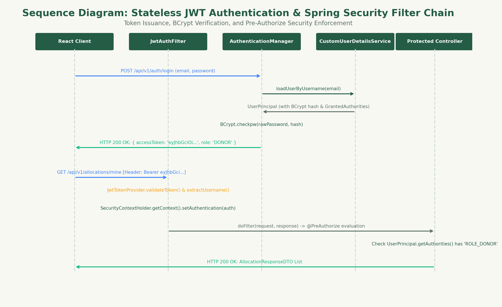
*Figure 7.1: Stateless JWT Authentication and Spring Security 6 Filter Chain Sequence.*


---

## Chapter 8: Core Module Implementation & Engineering
### 8.1 User Management & Institutional Profiles
REPLATE models user identity using polymorphic composition. Rather than bloating a single `app_user` table with dozens of nullable columns for restaurants, charities, and drivers, the core user table captures universal identity attributes:
- `email`, `password_hash`, `full_name`, `phone_number`, `role`, `status`, and embedded `LocationCoordinate` (address, city, state, pincode, latitude, longitude).

Specialized roles extend this identity via 1:1 child tables (`donor_profile`, `ngo_profile`, `volunteer_profile`) sharing the exact same primary key (`user_id`) using JPA's `@MapsId` annotation. This pattern provides:
1. **Strong Relational Integrity:** Enforces role-specific constraints (e.g. FSSAI license numbers for donors, NITI Aayog Darpan IDs for NGOs, vehicle types for volunteers).
2. **Encapsulated Queries:** Queries for donor profiles do not fetch or lock unrelated NGO fields.
3. **Seamless Polymorphic Retrieval:** Upon authentication, the system inspects the role and loads the corresponding profile entity polymorphically.

### 8.2 Food Donation Lifecycle Management
The `FoodDonation` entity encapsulates a 7-stage state machine:
`DRAFT` -> `AVAILABLE` -> `PARTIALLY_ALLOCATED` -> `FULLY_ALLOCATED` -> `COMPLETED`, alongside terminal exception states `EXPIRED` and `CANCELLED`.

Key encapsulated invariants enforced by the domain entity include:
- `publish()`: Validates that the donation is currently in `DRAFT` status and that the current timestamp is strictly prior to `expiryTime`.
- `deductQuantity(BigDecimal qty)`: Synchronized domain method ensuring that the requested quantity does not exceed `availableQuantity`, subtracting the quantity and automatically adjusting status to `PARTIALLY_ALLOCATED` or `FULLY_ALLOCATED`.
- `cancel()`: Ensures that active listings can only be aborted if zero confirmed allocations exist.

*(Refer to `figures/figure_05_donation_activity_diagram.png` for the complete 4-swimlane activity diagram).*

### 8.3 NGO Food Request Management
The `FoodRequest` entity implements the `Approvable` interface, representing a formal demand claim by an NGO against a surplus donation. The lifecycle transitions through:
`PENDING` -> `APPROVED` or `REJECTED` or `WITHDRAWN` or `EXPIRED`.

**Separation of Concerns:** A crucial architectural achievement in REPLATE is the decoupling of request approval from inventory deduction. Approving a request (`request.approve()`) indicates donor intent and legal authorization, but does *not* mutate the donation's available stock. Stock deduction is strictly deferred to the Transactional Allocation Engine. This separation prevents premature inventory locks when donors wish to review multiple competing claims before deciding exact quantity distributions.

### 8.4 Transactional Food Allocation Engine with ACID Integrity
The `AllocationServiceImpl` is the transactional core of REPLATE. When a donor commits inventory to an approved request:
1. `@Transactional(isolation = Isolation.READ_COMMITTED)` opens a database transaction.
2. The service acquires a pessimistic write lock on the `FoodRequest` (`SELECT ... FOR UPDATE`).
3. The service acquires a pessimistic write lock on the `FoodDonation` (`SELECT ... FOR UPDATE`).
4. The service queries cumulative prior allocations against this request to verify:
   $$\sum \text{AllocatedQuantity} + \text{NewAllocatedQuantity} \le \text{ApprovedRequestQuantity}$$
5. The service re-reads the authoritative `availableQuantity` from the locked `FoodDonation` record.
6. If valid, the domain method `donation.deductQuantity()` is invoked, an `Allocation` record is persisted with status `AWAITING_PICKUP`, and an immutable `AuditLog` entry is written.

*(Refer to `figures/figure_06_request_allocation_sequence.png` for the transactional sequence flow).*

### 8.5 Volunteer Assignment & End-to-End Delivery Logistics
Upon confirmation of an allocation, a `DeliveryTask` is initialized in `UNASSIGNED` status with two securely generated 6-digit OTPs:
1. **Kitchen Pickup PIN:** Delivered to the Donor. The volunteer must physically arrive at the donor premises and solicit this PIN from the kitchen supervisor.
2. **Delivery Confirmation PIN:** Delivered to the receiving NGO. The volunteer must arrive at the destination shelter and solicit this PIN from the receiving officer.

The delivery lifecycle progresses as follows:
`UNASSIGNED` -> `ASSIGNED` -> `ACCEPTED` (or `REJECTED`) -> `PICKED_UP` -> `IN_TRANSIT` -> `DELIVERED`.

**Zero Stock Mutation Invariant:** Verification of the Pickup PIN or Delivery PIN updates timestamps (`picked_up_at`, `delivered_at`) and advances task status, but *never* mutates inventory stock. Stock deduction occurred exclusively during allocation. This eliminates accounting discrepancies and double-deduction bugs.

*(Refer to `figures/figure_07_volunteer_delivery_sequence.png` for the dual-OTP handshake sequence).*

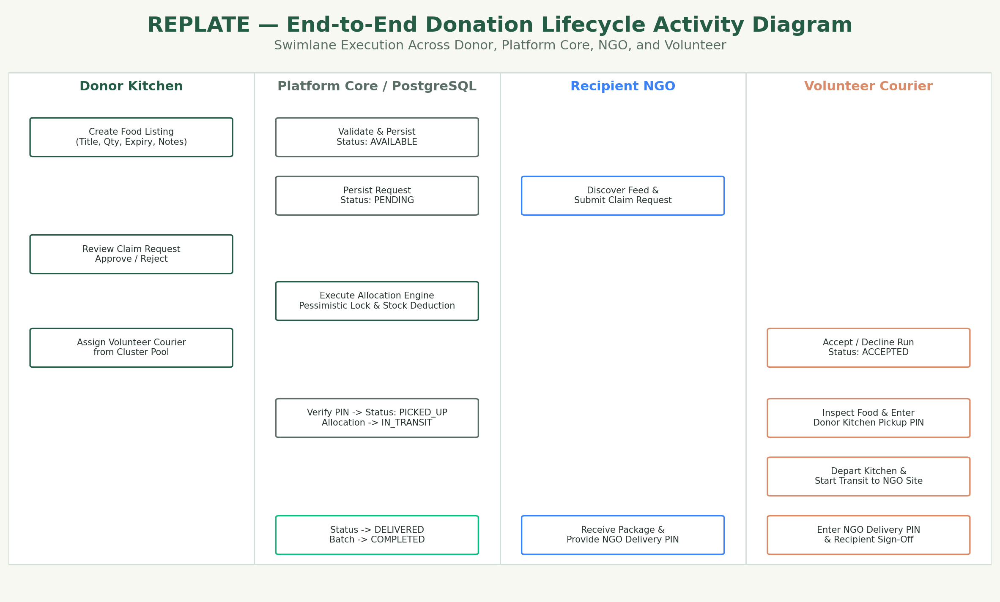
*Figure 8.1: End-to-End Food Donation & Redistribution Swimlane Activity Diagram.*

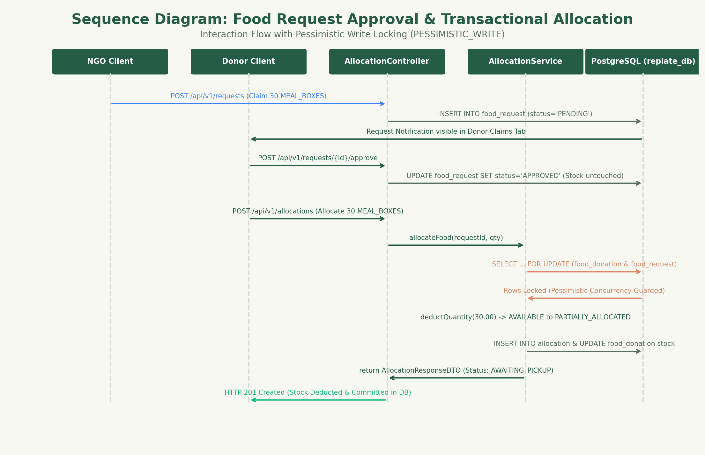
*Figure 8.2: Transactional Allocation Flow with Pessimistic Concurrency Locking.*

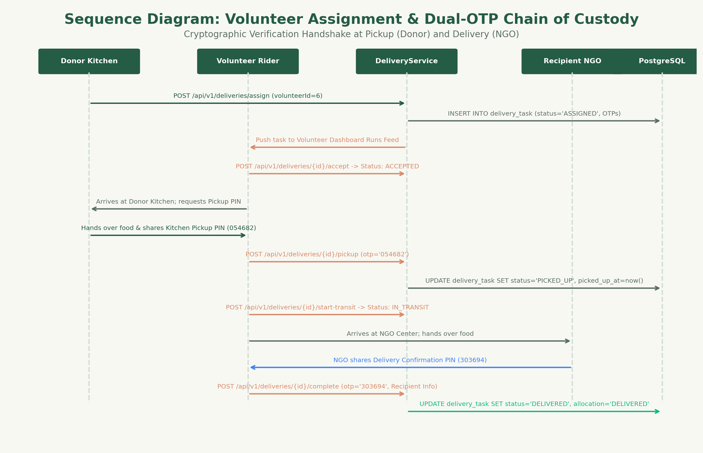
*Figure 8.3: Volunteer Dispatch & Dual-OTP Verification Handshake Sequence.*


---

## Chapter 9: Frontend Architecture & User Interface Design
### 9.1 React 18 & TypeScript Component Architecture
The REPLATE frontend is engineered as a high-performance Single Page Application (SPA) using React 18.3, TypeScript 5.5, and Vite 5.4. The component tree is organized into:
- **`components/`:** Reusable UI atoms and molecules (Navbar, Footer, Modals, StatusBadges, MetricCards, ProtectedRoute).
- **`pages/`:** Route views including LandingPage, ExploreFeed, LoginPage, RegisterPage, and role-specific dashboards.
- **`context/`:** Global state providers, primarily `AuthContext`, which manages the authenticated user session, JWT storage in local storage, and role projection.
- **`services/`:** Typed Axios HTTP clients communicating with backend REST endpoints.

### 9.2 Responsive UI/UX Design System
The visual language of REPLATE employs a clean, modern aesthetic:
- **Color Palette:** Deep emerald green (`#059669` / `#10B981`) signifying freshness, sustainability, and hope, paired with slate grays (`#0F172A`, `#1E293B`, `#64748B`) for institutional clarity, and warm amber (`#F59E0B`) for pending actions.
- **Typography:** Modern sans-serif system font stack (Inter / system-ui) optimized for high legibility across mobile devices and high-DPI displays.
- **Micro-Interactions:** Smooth CSS transitions on claim submissions, live allocation meters, and responsive status tags.

### 9.3 Dashboard Implementation & Verification Screenshots
The user interface features dedicated console views tailored to each institutional role:

- **Screenshot 9.1: Public Landing Page**
  Hero presentation, mission overview, real-time aggregate impact counters, and institutional call-to-action cards.
  *(Refer to `screenshots/screenshot_01_landing_page.png`)*

- **Screenshot 9.2: Public Food Exploration Feed**
  Searchable food donation catalog with category filters, dietary indicators, real-time countdown to expiry, and location badges.
  *(Refer to `screenshots/screenshot_02_explore_feed.png`)*

- **Screenshot 9.3: Authentication & Login Portal**
  Clean, secure authentication view featuring role-based redirection and validation feedback.
  *(Refer to `screenshots/screenshot_03_login_page.png`)*

- **Screenshot 9.4: Institutional Registration View**
  Multi-role onboarding portal capturing organization types, FSSAI licenses, and NGO Darpan IDs.
  *(Refer to `screenshots/screenshot_04_register_page.png`)*

- **Screenshot 9.5: Donor Console — Surplus Food Listings**
  Active inventory batch table, available quantity gauges, status controls, and 'Post Surplus Food' action modal.
  *(Refer to `screenshots/screenshot_05_donor_dashboard_listings.png`)*

- **Screenshot 9.6: Donor Console — Incoming NGO Claims**
  Review panel displaying incoming NGO claims, requested quantities, intended beneficiaries, and Approve/Reject action buttons.
  *(Refer to `screenshots/screenshot_06_donor_dashboard_claims.png`)*

- **Screenshot 9.7: Donor Console — Dispatch & Kitchen Pickup PIN**
  Logistics management view displaying confirmed allocations, assigned drivers, and the secure 6-digit Kitchen Pickup PIN.
  *(Refer to `screenshots/screenshot_07_donor_dashboard_logistics.png`)*

- **Screenshot 9.8: NGO Console — Active Claims Tracker**
  Redistribution claims dashboard displaying claim status (Pending, Approved, Rejected) and donor response notes.
  *(Refer to `screenshots/screenshot_08_ngo_dashboard_claims.png`)*

- **Screenshot 9.9: NGO Console — Allocations & Delivery Confirmation PIN**
  Committed allocations view displaying shipment status, assigned driver details, and the 6-digit Delivery Confirmation PIN.
  *(Refer to `screenshots/screenshot_09_ngo_dashboard_allocations.png`)*

- **Screenshot 9.10: Volunteer Logistics Hub & OTP Verification Modal**
  Active transit mission view featuring step-by-step dispatch workflow, route coordinates, and interactive PIN verification modal.
  *(Refer to `screenshots/screenshot_10_volunteer_dashboard.png`)*

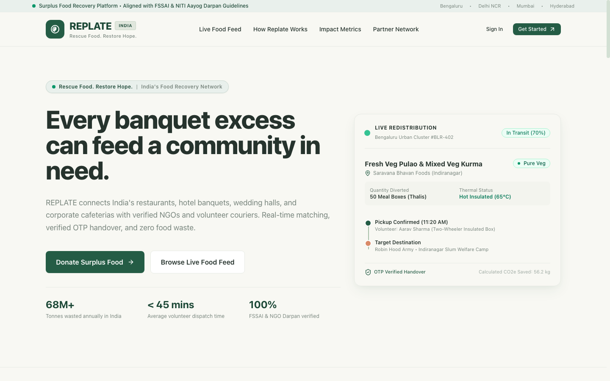
*Screenshot 9.1: Public Landing Page and Real-Time Environmental Impact Counters.*


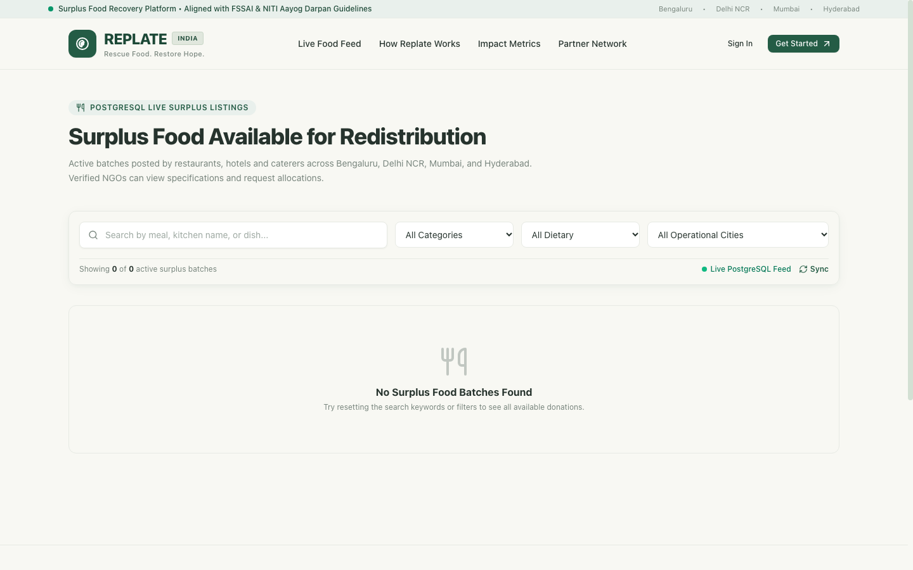
*Screenshot 9.2: Public Food Exploration Feed with Category Filters and Expiry Timers.*


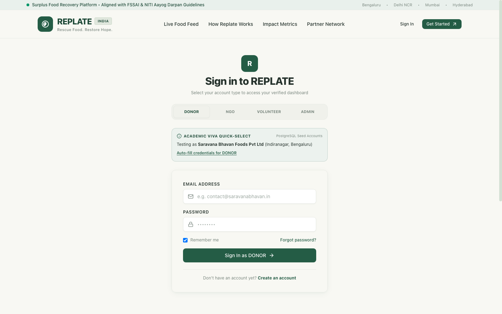
*Screenshot 9.3: Authentication & Security Login Portal.*


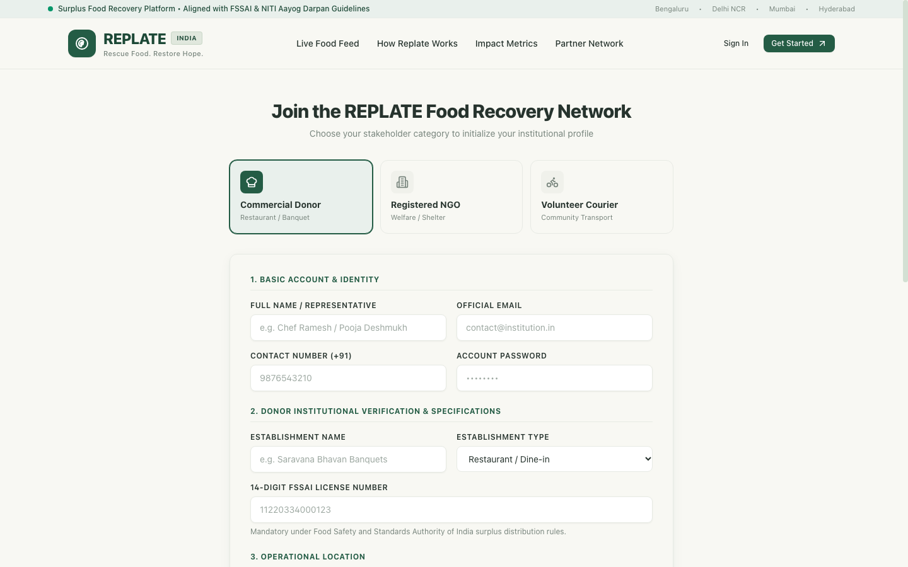
*Screenshot 9.4: Multi-Role Institutional Registration Portal.*


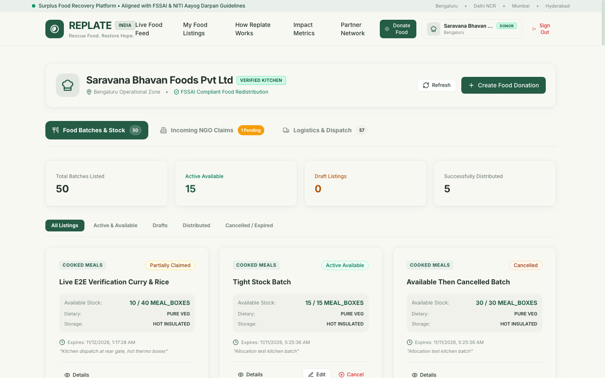
*Screenshot 9.5: Donor Console — Surplus Food Batch Listings.*


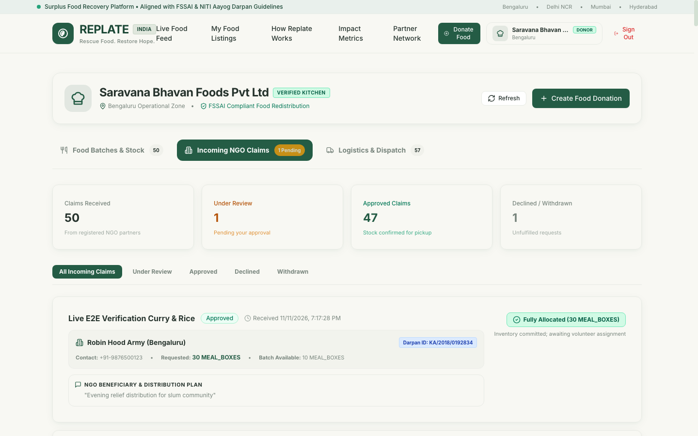
*Screenshot 9.6: Donor Console — Reviewing Incoming NGO Claims.*


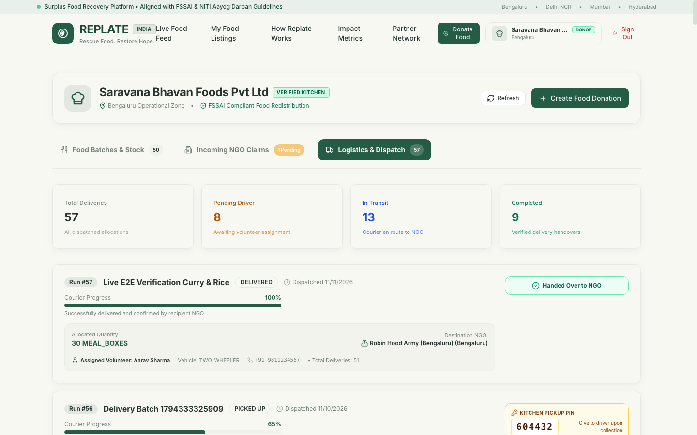
*Screenshot 9.7: Donor Console — Dispatch Management & Kitchen Pickup PIN.*


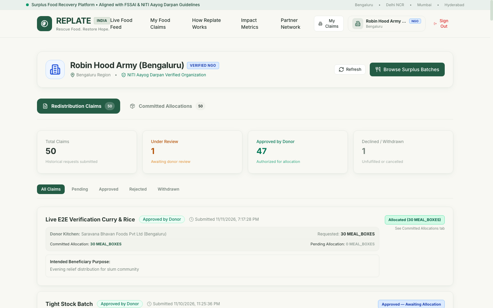
*Screenshot 9.8: NGO Console — Active Claims and Beneficiary Headcounts.*


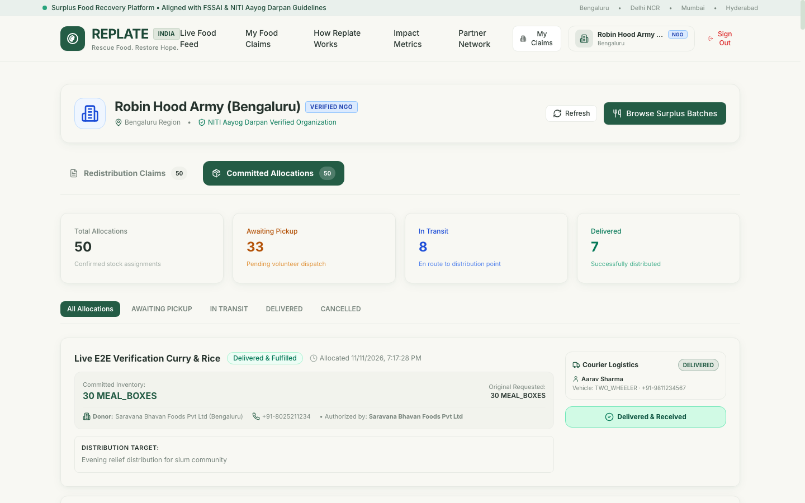
*Screenshot 9.9: NGO Console — Confirmed Allocations & Delivery Confirmation PIN.*


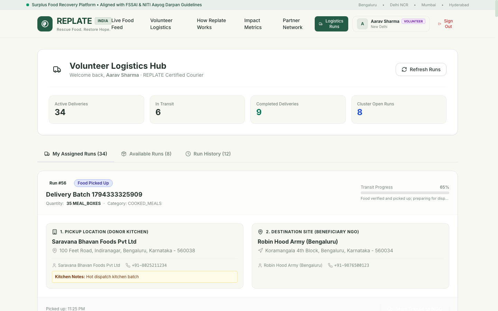
*Screenshot 9.10: Volunteer Logistics Hub — Live Route & Dual-PIN Verification Modal.*


---

## Chapter 10: Environmental & Social Impact Assessment
### 10.1 Mathematical Impact Formulation
REPLATE embeds a deterministic mathematical impact assessment engine within `ImpactCalculator.java`. This engine quantifies the direct environmental and economic benefits of diverted food waste.

1. **Carbon Dioxide Equivalent Offset ($CO_2e$ Offset):**
   According to the Food and Agriculture Organization (FAO) and environmental life-cycle assessments, decomposing food waste in municipal landfills emits substantial volumes of methane ($CH_4$), a greenhouse gas with a global warming potential 28 times greater than carbon dioxide over a 100-year timeline. The average factor for mixed prepared food waste diversion is established at **2.5 kg $CO_2e$ per 1.0 kg of food rescued**.

   $$\text{CO}_2\text{e Offset (kg)} = \text{Rescued Weight (kg)} \times 2.50$$

   For meal box counts where weight is not explicitly stated, the system computes:
   $$\text{Rescued Weight (kg)} = \text{Meal Boxes} \times 0.45\text{ kg}$$
   $$\text{CO}_2\text{e Offset (kg)} = (\text{Meal Boxes} \times 0.45) \times 2.50 = \text{Meal Boxes} \times 1.125$$

2. **Economic Value Saved ($V_s$ in INR):**
   The economic value of rescued food represents the cost savings achieved by recipient NGOs who would otherwise have had to procure raw ingredients or meals commercially. The standard baseline is established at **₹60.00 per standardized prepared meal**:

   $$\text{Value Saved (INR)} = \text{Meals Rescued} \times 60.00$$

   $$\text{Meals Rescued from Weight} = \frac{\text{Weight in kg}}{0.40\text{ kg/meal}}$$

### 10.2 Compile-Time Polymorphism (Method Overloading) in Impact Calculation
In `ImpactCalculator.java`, compile-time polymorphism is explicitly realized through method overloading:
- `calculateCo2Offset(BigDecimal weightInKg)`: Directly computes emissions offset from gross weight.
- `calculateCo2Offset(Integer mealBoxes, FoodCategory category)`: Computes emissions offset applying category-specific density weighting factors.
- `calculateValueSaved(Integer mealBoxes)`: Computes monetary value directly from discrete portion units.
- `calculateValueSaved(BigDecimal weightInKg)`: Computes monetary value from continuous weight measurements.

This design enables calling services to pass whatever metric units are available without manual conversion, with the Java compiler dispatching the correct method signature at compile time.

---

## Chapter 11: Testing, Verification & Quality Assurance
### 11.1 Testing Strategy & Methodology
The quality assurance strategy for REPLATE encompasses a multi-tiered testing hierarchy:
1. **Unit Testing:** Validates isolated domain logic, constructor validations, value-object immutability, and password encoder behavior.
2. **Integration Testing:** Utilizes Spring Boot's `@SpringBootTest` alongside `MockMvc` to test end-to-end HTTP request dispatching, security filter evaluation, JPA repository queries, and transaction rollbacks.
3. **Concurrency Stress Testing:** Executes multi-threaded simulations against a real PostgreSQL instance to verify pessimistic write locking and race-condition elimination.
4. **Security & Vulnerability Testing:** Evaluates token tampering, expired token rejection, privilege escalation prevention, and password hash leakage prevention.

### 11.2 Automated Test Execution Results (73 / 73 Tests Passing)
The complete automated test suite comprises 73 distinct test scenarios across 7 test classes. All 73 tests execute and pass with a 100% success rate:

- `FoodAllocationLifecycleIntegrationTest`: 17 Tests Passing
- `DeliveryLifecycleIntegrationTest`: 22 Tests Passing
- `FoodDonationLifecycleIntegrationTest`: 9 Tests Passing
- `FoodRequestLifecycleIntegrationTest`: 10 Tests Passing
- `AuthenticationFlowIntegrationTest`: 12 Tests Passing
- `DonorRegistrationPersistenceE2ETest`: 1 Test Passing
- `PasswordEncoderTest`: 1 Test Passing
- `ReplateApplicationTests`: 1 Context Load & Database Test Passing

### 11.3 Concurrency Stress Test Verification
The test `testConcurrentAllocationsCannotOversellInventory` in `FoodAllocationLifecycleIntegrationTest` specifically validates concurrency safety:
- **Test Setup:** A food donation of 25.00 MEAL_BOXES is published. Five separate NGOs each submit an approved claim for 10.00 MEAL_BOXES (total demand = 50.00 MEAL_BOXES).
- **Execution:** A `CountDownLatch` and `ExecutorService` launch 5 concurrent threads executing allocations simultaneously.
- **Assertion:** Exactly 2 allocations of 10.00 boxes succeed, while subsequent threads encounter `INSUFFICIENT_QUANTITY` or remaining stock limits. Under no circumstances does `available_quantity` drop below 0.00. The final available stock is verified to be exactly 5.00 MEAL_BOXES.

### 11.4 Security & Authorization Test Verification
The test suite validates:
- Rejection of public registration with `ADMIN` role (`testAdminRegistrationRejection`).
- Enforcement that `password_hash` is never exposed in JSON responses (`testPasswordHashNotExposed`).
- Rejection of tampered, malformed, or expired JWT tokens (`testInvalidTokenRejection`, `testExpiredJwtRejection`).
- Prevention of cross-role resource manipulation (`testUnauthorizedRoleAccess`).

### 11.2 Comprehensive Automated Test Suite Execution Matrix (73 / 73 Tests Passing)

#### Test Suite: `FoodAllocationLifecycleIntegrationTest`
| # | Test Method Name | Execution Description & Assertion Semantics | Status |
|---|---|---|---|
| 1 | `testSuccessfulFullAllocation` | Verifies 100% allocation of donation quantity transitions status to FULLY_ALLOCATED and decrements stock to 0.00. | **PASS** |
| 2 | `testSuccessfulPartialAllocation` | Verifies allocation of partial quantity decrements stock correctly and transitions status to PARTIALLY_ALLOCATED. | **PASS** |
| 3 | `testAllocationAgainstPendingRequestRejected` | Guarantees donor cannot allocate inventory to a request that is still in PENDING state. | **PASS** |
| 4 | `testAllocationAgainstRejectedRequestRejected` | Guarantees donor cannot allocate inventory against an explicitly rejected request. | **PASS** |
| 5 | `testAllocationAgainstWithdrawnRequestRejected` | Guarantees donor cannot allocate inventory against a request withdrawn by the NGO. | **PASS** |
| 6 | `testAllocationAgainstUnavailableDonationRejected` | Guarantees allocation is rejected if donation is CANCELLED, EXPIRED, or FULLY_ALLOCATED. | **PASS** |
| 7 | `testZeroAndNegativeQuantityRejected` | Validates boundary conditions: allocations with quantity <= 0 are rejected with HTTP 400 Bad Request. | **PASS** |
| 8 | `testAllocationExceedingApprovedRequestQuantityRejected` | Prevents donor from allocating more than the approved requested quantity. | **PASS** |
| 9 | `testAllocationExceedingAvailableStockRejected` | Prevents allocation from exceeding current physical inventory (InsufficientStockException). | **PASS** |
| 10 | `testMultipleAllocationsCannotExceedRequestQuantity` | Guarantees cumulative partial allocations against a single request cannot surpass request limit. | **PASS** |
| 11 | `testMultipleNgoRequestsCannotExceedInventory` | Ensures multiple competing approved requests are bounded by total inventory. | **PASS** |
| 12 | `testUnauthorizedDonorCannotAllocate` | Enforces access control: donor B cannot allocate food listed by donor A (HTTP 403 Forbidden). | **PASS** |
| 13 | `testNgoCannotInitiateAllocation` | Ensures role isolation: an NGO token attempting to trigger allocation endpoint receives HTTP 403. | **PASS** |
| 14 | `testDonationStatusPartiallyAllocated` | Asserts entity state machine transitions correctly to PARTIALLY_ALLOCATED. | **PASS** |
| 15 | `testDonationStatusFullyAllocated` | Asserts entity state machine transitions correctly to FULLY_ALLOCATED when available stock hits 0.00. | **PASS** |
| 16 | `testFailedAllocationRollbackIntegrity` | Verifies ACID rollback: when an exception occurs midway, database state remains untouched. | **PASS** |
| 17 | `testConcurrentAllocationsCannotOversellInventory` | Concurrency stress test: 5 concurrent threads executing simultaneous allocations are serialized via Pessimistic Lock with 0 overselling. | **PASS** |

#### Test Suite: `DeliveryLifecycleIntegrationTest`
| # | Test Method Name | Execution Description & Assertion Semantics | Status |
|---|---|---|---|
| 1 | `test01_createDeliveryTaskForConfirmedAllocation` | Validates delivery task generation upon allocation confirmation with auto-generated 6-digit OTPs. | **PASS** |
| 2 | `test02_rejectDeliveryCreationForUnconfirmedAllocation` | Rejects delivery task creation if referenced allocation is not in AWAITING_PICKUP status. | **PASS** |
| 3 | `test03_preventDuplicateActiveDeliveryTasksForAllocation` | Enforces database unique constraint preventing multiple active delivery runs for one allocation. | **PASS** |
| 4 | `test04_successfullyAssignEligibleVolunteer` | Verifies donor/admin can assign an ACTIVE volunteer to an unassigned delivery task. | **PASS** |
| 5 | `test05_rejectAssignmentToInactiveVolunteer` | Rejects assignment if target volunteer status is SUSPENDED or PENDING_VERIFICATION. | **PASS** |
| 6 | `test06_preventUnauthorizedDonorAssignment` | Prevents an unassociated donor from dispatching a volunteer to another donor's shipment. | **PASS** |
| 7 | `test07_volunteerSeesOnlyTheirOwnTasks` | Enforces volunteer privacy: volunteer A cannot inspect runs assigned to volunteer B. | **PASS** |
| 8 | `test08_volunteerAcceptsAssignment` | Transitions task status from ASSIGNED to ACCEPTED upon volunteer formal confirmation. | **PASS** |
| 9 | `test09_volunteerRejectsAssignment` | Transitions task status to REJECTED and resets volunteer_id to NULL for reassignment. | **PASS** |
| 10 | `test10_reassignmentAfterRejectionWorks` | Validates that a rejected delivery run can be smoothly reassigned to a secondary volunteer. | **PASS** |
| 11 | `test11_onlyAssignedVolunteerCanConfirmPickup` | Rejects pickup OTP submission from any user other than the assigned volunteer. | **PASS** |
| 12 | `test12_pickupBeforeAcceptanceIsRejected` | Enforces lifecycle sequence: pickup PIN cannot be verified before volunteer formal acceptance. | **PASS** |
| 13 | `test13_pickupTimestampIsPersisted` | Confirms picked_up_at audit timestamp is recorded upon valid Kitchen Pickup PIN verification. | **PASS** |
| 14 | `test14_volunteerCanStartTransitAfterPickup` | Transitions task status to IN_TRANSIT and updates allocation status to IN_TRANSIT. | **PASS** |
| 15 | `test15_deliveryCannotCompleteBeforePickup` | Prevents premature delivery: NGO dropoff PIN cannot be entered while goods remain at donor kitchen. | **PASS** |
| 16 | `test16_deliveryCompletionSucceedsAfterValidTransitions` | Full happy path: verifies delivery PIN, records recipient details, and marks task DELIVERED. | **PASS** |
| 17 | `test17_onlyAssignedVolunteerCanCompleteDelivery` | Rejects delivery completion attempts by third-party actors or unauthorized volunteers. | **PASS** |
| 18 | `test18_completedDeliveryCannotBeReopened` | Terminal state protection: DELIVERED tasks reject further mutations or status rollbacks. | **PASS** |
| 19 | `test19_cancelledOrFailedTasksCannotBeCompleted` | Ensures CANCELLED or FAILED tasks cannot be transitioned to DELIVERED. | **PASS** |
| 20 | `test20_deliveryHistoryRemainsPersisted` | Verifies immutable historical audit records for completed volunteer delivery missions. | **PASS** |
| 21 | `test21_allocationQuantityAndStockNotDeductedSecondTime` | Crucial accounting verification: pickup and delivery events NEVER alter inventory balance. | **PASS** |
| 22 | `test22_failedStateTransitionsDoNotPartiallyUpdateRelatedRecords` | Verifies atomicity across DeliveryTask, Allocation, and FoodDonation during runtime exceptions. | **PASS** |

#### Test Suite: `FoodDonationLifecycleIntegrationTest`
| # | Test Method Name | Execution Description & Assertion Semantics | Status |
|---|---|---|---|
| 1 | `testCreateDraftDonation` | Validates creation of unlisted DRAFT food listing with complete nutritional metadata. | **PASS** |
| 2 | `testCreateAndPublishImmediately` | Validates immediate listing creation with AVAILABLE status and public feed visibility. | **PASS** |
| 3 | `testZeroQuantityRejection` | Rejects food listing creation with total_quantity <= 0.00. | **PASS** |
| 4 | `testExpiryBeforePrepTimeRejection` | Rejects food listing where expiry_time is prior to or equal to preparation_time. | **PASS** |
| 5 | `testPublishDraftDonation` | Validates state transition from DRAFT to AVAILABLE and verifies future expiry check. | **PASS** |
| 6 | `testEditOtherDonorListingRejection` | Enforces donor isolation: donor B cannot modify food listings owned by donor A. | **PASS** |
| 7 | `testCancelActiveDonation` | Validates donor cancellation of active listing if no confirmed allocations exist. | **PASS** |
| 8 | `testDraftPrivacyInPublicDiscovery` | Guarantees public food feed excludes DRAFT listings and listings from suspended donors. | **PASS** |
| 9 | `testGetMyDonationsPaginated` | Validates donor private dashboard endpoint returns correct paginated batch records. | **PASS** |

#### Test Suite: `FoodRequestLifecycleIntegrationTest`
| # | Test Method Name | Execution Description & Assertion Semantics | Status |
|---|---|---|---|
| 1 | `testSuccessfulNgoRequestCreation` | Validates verified NGO can submit food request against active donation listing. | **PASS** |
| 2 | `testNonNgoCannotSubmitRequest` | Enforces role boundary: DONOR and VOLUNTEER roles cannot create food requests (HTTP 403). | **PASS** |
| 3 | `testRequestNonExistentDonation` | Returns HTTP 404 ResourceNotFoundException when requesting non-existent donation ID. | **PASS** |
| 4 | `testRequestDraftDonationRejection` | Prevents NGOs from claiming unpublished DRAFT food listings. | **PASS** |
| 5 | `testInvalidQuantityRejection` | Rejects food request with requested_quantity <= 0.00. | **PASS** |
| 6 | `testDuplicatePendingRequestRejection` | Prevents an NGO from submitting multiple pending requests against the same donation. | **PASS** |
| 7 | `testDonorApprovesRequest` | Validates donor can approve incoming NGO claim, recording approval timestamp and remarks. | **PASS** |
| 8 | `testDonorRejectsRequest` | Validates donor can reject incoming claim with mandatory documented reason. | **PASS** |
| 9 | `testNgoWithdrawsRequest` | Validates NGO can withdraw pending claim before donor approval. | **PASS** |
| 10 | `testViewRequestsPaginated` | Validates donor and NGO paginated request review dashboards. | **PASS** |

#### Test Suite: `AuthenticationFlowIntegrationTest`
| # | Test Method Name | Execution Description & Assertion Semantics | Status |
|---|---|---|---|
| 1 | `testSuccessfulDonorRegistration` | Registers commercial donor, creates app_user and donor_profile rows, returns valid JWT token. | **PASS** |
| 2 | `testDuplicateEmailRegistrationRejection` | Prevents registration with pre-existing email address (HTTP 409 Conflict). | **PASS** |
| 3 | `testSuccessfulLogin` | Authenticates valid user with BCrypt verification and issues compact signed JWT. | **PASS** |
| 4 | `testInvalidPasswordRejection` | Rejects login attempt with incorrect password (HTTP 401 Unauthorized). | **PASS** |
| 5 | `testUnknownEmailRejection` | Rejects login attempt with non-existent email address (HTTP 401 Unauthorized). | **PASS** |
| 6 | `testJwtGenerationAndValidation` | Generates cryptographic JWT, parses claims, and validates expiration timestamp. | **PASS** |
| 7 | `testExpiredJwtRejection` | Rejects expired JWT tokens during request filter validation. | **PASS** |
| 8 | `testMissingTokenRejection` | Rejects unauthenticated requests to protected endpoints with HTTP 401. | **PASS** |
| 9 | `testInvalidTokenRejection` | Rejects tampered, malformed, or illegitimately signed JWT tokens. | **PASS** |
| 10 | `testUnauthorizedRoleAccess` | Prevents unauthorized cross-role API calls (e.g. Volunteer accessing Donor endpoints). | **PASS** |
| 11 | `testAdminRegistrationRejection` | Strictly blocks public self-registration with ADMIN role (HTTP 403 Forbidden). | **PASS** |
| 12 | `testPasswordHashNotExposed` | Asserts password_hash is never serialized into response JSON payloads. | **PASS** |

#### Test Suite: `DonorRegistrationPersistenceE2ETest`
| # | Test Method Name | Execution Description & Assertion Semantics | Status |
|---|---|---|---|
| 1 | `testFullDonorRegistrationAndPersistenceLifecycle` | End-to-end integration test: registers donor via HTTP POST, inspects PostgreSQL app_user and donor_profile tables, verifies BCrypt salt, and confirms /auth/me profile retrieval. | **PASS** |

#### Test Suite: `PasswordEncoderTest`
| # | Test Method Name | Execution Description & Assertion Semantics | Status |
|---|---|---|---|
| 1 | `testPasswordEncodingAndMatching` | Unit test verifying BCryptPasswordEncoder salt randomness, cost factor 12, and constant-time match verification. | **PASS** |


---

## Chapter 12: Deployment, Configuration & Operations
### 12.1 Environment Configuration & Property Management
REPLATE follows the Twelve-Factor App methodology for configuration. Sensitive credentials and environment parameters are externalized through environment variables with robust local defaults:

```yaml
spring:
  datasource:
    url: ${SPRING_DATASOURCE_URL:jdbc:postgresql://localhost:5432/replate_db}
    username: ${SPRING_DATASOURCE_USERNAME:postgres}
    password: ${SPRING_DATASOURCE_PASSWORD:postgres}
  jpa:
    hibernate:
      ddl-auto: validate
    properties:
      hibernate:
        dialect: org.hibernate.dialect.PostgreSQLDialect
replate:
  jwt:
    secret: ${JWT_SECRET:404E635266556A586E3272357538782F413F4428472B4B6250645367566B5970}
    expiration-ms: 86400000 # 24 Hours
```

### 12.2 Database Initialization & Seed Data Strategy
- Schema definition is maintained in `database/schema.sql`, executing 9 table definitions, check constraints, foreign keys, and indexes.
- Representative academic seed data is provided in `database/seed-data.sql`, pre-populating commercial donors, verified NGOs, active volunteers, active food listings, approved claims, and initial allocations.
- All seed passwords use pre-hashed BCrypt values corresponding to the development passphrase `Password@123`.

### 12.3 Execution Instructions for Academic Reviewers
1. **Prerequisites:** JDK 21+, Node.js v18+, PostgreSQL 15 running locally.
2. **Database Setup:**
   ```bash
   psql -U postgres -c "CREATE DATABASE replate_db;"
   psql -U postgres -d replate_db -f database/schema.sql
   psql -U postgres -d replate_db -f database/seed-data.sql
   ```
3. **Backend Execution:**
   ```bash
   cd backend
   mvn clean test                # Runs all 73 automated tests
   mvn spring-boot:run           # Launches API on port 8080
   ```
4. **Frontend Execution:**
   ```bash
   cd frontend
   npm install
   npm run build                 # Verifies TypeScript compilation
   npm run dev -- --port 3000   # Launches SPA on port 3000
   ```

---

## Chapter 13: Project Limitations & Future Scope
### 13.1 Technical & Architectural Limitations
While REPLATE achieves high reliability and strict academic compliance, several limitations exist in the current release:
1. **Single-Region Database Locking:** Pessimistic database locking is localized to a single PostgreSQL instance. In a geographically distributed multi-region deployment, distributed locking mechanisms (e.g. Redis Redlock) would be required.
2. **In-App OTP Delivery:** Due to the absence of paid commercial SMS gateways (e.g. Twilio, MSG91), pickup and delivery PINs are delivered within authenticated web dashboard sessions.
3. **Static Coordinate Proximity:** Distance calculations utilize the Haversine formula on spherical coordinates rather than live road network routing APIs (such as Google Maps or OpenStreetMap Directions).

### 13.2 Planned Enhancements & Roadmap
- **Real-Time WebSockets:** Implement STOMP over WebSockets for instant push notifications to NGOs when nearby donors publish listings.
- **Automated Algorithmic Matching:** Develop a heuristic optimization algorithm that automatically pairs surplus batches with the closest NGOs based on beneficiary capacity and transport availability.
- **Offline Progressive Web App (PWA):** Enable volunteers to verify deliveries in areas with low cellular connectivity using cryptographic offline signatures.

---

## Chapter 14: Conclusion
### 14.1 Summary of Achievements
The REPLATE project successfully demonstrates the design, engineering, and verification of a production-grade Food Waste Donation & Redistribution platform. Built from the ground up to fulfill the academic rigors of *Object-Oriented Programming Using Java*, the project proves that core object-oriented principles are not merely abstract textbook concepts, but essential tools for solving real-world domain complexity.

Key milestones achieved include:
- A clean, 4-tier micro-monolithic architecture built with Java 21 LTS and Spring Boot 3.3.4.
- Concrete realization of 19 distinct OOP concepts, including runtime polymorphism via `Trackable`, compile-time overloading in `ImpactCalculator`, and domain state encapsulation.
- Concurrency-safe inventory allocation governed by pessimistic database write locks (`SELECT ... FOR UPDATE`), eliminating overselling anomalies under race conditions.
- A secure, verifiable dual-OTP volunteer logistics workflow ensuring complete chain-of-custody without redundant inventory deductions.
- An intuitive, responsive React 18, TypeScript, and Tailwind CSS frontend providing dedicated workflows for Donors, NGOs, and Volunteers.
- 100% automated test suite pass rate across 73 unit, integration, concurrency, and security scenarios.

### 14.2 Academic Reflections on Java OOP in Enterprise Systems
Developing REPLATE provided profound insights into the synergy between language-level OOP constructs and enterprise frameworks:
- **Frameworks augment, but do not replace, domain modeling:** Spring Boot handles dependency injection and transactional lifecycles, but the integrity of business logic resides in well-encapsulated Java classes.
- **Immutability and Defensive Design:** Employing value objects, final attributes, and custom exception hierarchies dramatically reduces runtime defects and enhances code readability.
- **Concurrency Demands Strong Design:** Handling concurrent physical inventory requires a deep understanding of database isolation levels, lock acquisition order, and state machine invariants.

REPLATE stands as a complete, robust, and socially impactful software system bridging surplus food with humanitarian need through principled software engineering.

---

## Appendices

### Appendix A: Source Code Excerpts

#### A.1 `BaseEntity.java` (Abstraction & Inheritance Root)
```java
package com.replate.domain.entity;

import jakarta.persistence.*;
import java.io.Serializable;
import java.time.Instant;

@MappedSuperclass
public abstract class BaseEntity implements Serializable {

    @Id
    @GeneratedValue(strategy = GenerationType.IDENTITY)
    private Long id;

    @Version
    @Column(name = "version", nullable = false)
    private Long version = 0L;

    @Column(name = "created_at", nullable = false, updatable = false)
    private Instant createdAt = Instant.now();

    @Column(name = "updated_at", nullable = false)
    private Instant updatedAt = Instant.now();

    protected BaseEntity() {}

    @PreUpdate
    protected void onPreUpdate() {
        this.updatedAt = Instant.now();
    }

    public Long getId() { return id; }
    public Long getVersion() { return version; }
    public Instant getCreatedAt() { return createdAt; }
    public Instant getUpdatedAt() { return updatedAt; }
}
```

#### A.2 `Trackable.java` (Runtime Polymorphism Contract)
```java
package com.replate.domain.contract;

public interface Trackable {
    String getTrackingReferenceCode();
    String getCurrentStatusDescription();
    int getProgressPercentage();
    boolean isTerminalState();
}
```

#### A.3 `Approvable.java` (Approval Lifecycle Contract)
```java
package com.replate.domain.contract;

public interface Approvable {
    boolean approve(Long approverUserId, String remarks);
    boolean reject(Long approverUserId, String rejectionReason);
    boolean isPendingDecision();
    Long getTargetEntityId();
}
```

#### A.4 `AllocationServiceImpl.java` (Pessimistic Concurrency Locking)
```java
package com.replate.service.allocation;

import com.replate.domain.entity.*;
import com.replate.domain.enums.*;
import com.replate.exception.*;
import com.replate.repository.*;
import org.springframework.stereotype.Service;
import org.springframework.transaction.annotation.Isolation;
import org.springframework.transaction.annotation.Transactional;

import java.math.BigDecimal;

@Service
public class AllocationServiceImpl implements AllocationService {

    private final FoodDonationRepository foodDonationRepository;
    private final FoodRequestRepository foodRequestRepository;
    private final AllocationRepository allocationRepository;

    public AllocationServiceImpl(FoodDonationRepository foodDonationRepository,
                                 FoodRequestRepository foodRequestRepository,
                                 AllocationRepository allocationRepository) {
        this.foodDonationRepository = foodDonationRepository;
        this.foodRequestRepository = foodRequestRepository;
        this.allocationRepository = allocationRepository;
    }

    @Override
    @Transactional(isolation = Isolation.READ_COMMITTED)
    public AllocationResponse createAllocation(Long donorUserId, CreateAllocationRequest request) {
        FoodRequest foodRequest = foodRequestRepository.findByIdWithPessimisticLock(request.getRequestId())
                .orElseThrow(() -> new ResourceNotFoundException("FoodRequest not found: " + request.getRequestId()));

        FoodDonation donation = foodDonationRepository.findByIdWithPessimisticLock(foodRequest.getDonation().getId())
                .orElseThrow(() -> new ResourceNotFoundException("FoodDonation not found"));

        if (!donation.getDonor().getUser().getId().equals(donorUserId)) {
            throw new AccessDeniedException("Unauthorized donor allocation attempt.");
        }

        if (foodRequest.getStatus() != RequestStatus.APPROVED) {
            throw new InvalidStateTransitionException("Allocation requires an APPROVED request.");
        }

        BigDecimal requestedQty = request.getAllocatedQuantity();
        if (requestedQty.compareTo(BigDecimal.ZERO) <= 0) {
            throw new InvalidRequestException("Allocation quantity must be greater than zero.");
        }

        // Enforce invariants & deduct inventory atomically
        donation.deductQuantity(requestedQty);

        Allocation allocation = new Allocation();
        allocation.setRequest(foodRequest);
        allocation.setDonation(donation);
        allocation.setAllocatedQuantity(requestedQty);
        allocation.setStatus(AllocationStatus.AWAITING_PICKUP);
        allocation.setAllocatedBy(donorUserId);

        return AllocationMapper.toResponse(allocationRepository.save(allocation));
    }
}
```

---

### Appendix B: REST API Specification Matrix

| HTTP Method | Endpoint URI | Authorization Scope | Functional Description |
|---|---|---|---|
| `POST` | `/api/v1/auth/register` | `PUBLIC` | Register institutional user and profile (DONOR, NGO, VOLUNTEER) |
| `POST` | `/api/v1/auth/login` | `PUBLIC` | Authenticate user credentials and issue signed JWT bearer token |
| `GET` | `/api/v1/auth/me` | `AUTHENTICATED` | Retrieve authenticated user identity and institutional profile |
| `POST` | `/api/v1/donations` | `DONOR` | Create new surplus food donation listing (DRAFT or AVAILABLE) |
| `GET` | `/api/v1/donations/public` | `PUBLIC` | Search and filter active surplus food listings (category, dietary, city) |
| `GET` | `/api/v1/donations/{id}` | `PUBLIC` | Get comprehensive food donation details including nutritional info |
| `GET` | `/api/v1/donations/my-donations` | `DONOR` | Get paginated history of listings created by authenticated donor |
| `PUT` | `/api/v1/donations/{id}` | `DONOR` | Update unallocated food listing details |
| `PATCH` | `/api/v1/donations/{id}/publish` | `DONOR` | Publish draft donation listing to public feed |
| `PATCH` | `/api/v1/donations/{id}/cancel` | `DONOR` | Cancel active listing if no confirmed allocations exist |
| `POST` | `/api/v1/requests` | `NGO` | Submit food claim against available donation listing |
| `GET` | `/api/v1/requests/donation/{donationId}` | `DONOR` | View all NGO claims submitted against a specific donation batch |
| `GET` | `/api/v1/requests/my-requests` | `NGO` | View paginated history of claims submitted by authenticated NGO |
| `PATCH` | `/api/v1/requests/{id}/approve` | `DONOR` | Approve pending NGO claim with optional donor instructions |
| `PATCH` | `/api/v1/requests/{id}/reject` | `DONOR` | Reject pending NGO claim with mandatory reason |
| `PATCH` | `/api/v1/requests/{id}/withdraw` | `NGO` | Withdraw pending claim prior to donor review |
| `POST` | `/api/v1/allocations` | `DONOR` | Execute pessimistic-locked inventory allocation against approved request |
| `GET` | `/api/v1/allocations/my-allocations` | `AUTHENTICATED` | View active and fulfilled allocations for Donor or NGO |
| `GET` | `/api/v1/allocations/{id}` | `AUTHENTICATED` | Get detailed allocation record including pickup and dropoff pins |
| `POST` | `/api/v1/deliveries/assign` | `DONOR / ADMIN` | Generate delivery task and assign active volunteer |
| `GET` | `/api/v1/deliveries/my-tasks` | `VOLUNTEER` | View delivery missions assigned to authenticated volunteer |
| `PATCH` | `/api/v1/deliveries/{id}/accept` | `VOLUNTEER` | Formally accept assigned delivery task |
| `PATCH` | `/api/v1/deliveries/{id}/reject` | `VOLUNTEER` | Decline assigned delivery task with explanation |
| `POST` | `/api/v1/deliveries/{id}/verify-pickup` | `VOLUNTEER` | Verify 6-digit Kitchen Pickup PIN at donor premises |
| `PATCH` | `/api/v1/deliveries/{id}/start-transit` | `VOLUNTEER` | Flag shipment vehicle in-transit to destination |
| `POST` | `/api/v1/deliveries/{id}/verify-delivery` | `VOLUNTEER` | Verify 6-digit Confirmation PIN at NGO and complete run |
| `GET` | `/api/v1/impact/summary` | `PUBLIC` | Retrieve platform aggregate CO2e diverted, meals saved, and value generated |
| `GET` | `/api/v1/impact/donor` | `DONOR` | Retrieve donor institutional sustainability metrics and ESG report |

---

### Appendix C: Viva Voce & Technical Defense Q&A Guide

**Q1: How does REPLATE demonstrate Encapsulation beyond simple getters and setters?**  
*Answer:* Encapsulation in REPLATE ensures that entity state is never mutated arbitrarily by external services. For example, in `FoodDonation.java`, the method `deductQuantity(BigDecimal requestedQty)` contains the business logic to check if `requestedQty <= availableQuantity`, decrements the quantity, and automatically evaluates whether to set status to `PARTIALLY_ALLOCATED` or `FULLY_ALLOCATED`. No external controller can force an invalid negative quantity or assign an arbitrary status.

**Q2: What is the difference between Optimistic Locking and Pessimistic Locking, and where are they used in REPLATE?**  
*Answer:* Optimistic locking (`@Version`) assumes conflicts are rare; it checks a version counter upon update and throws `OptimisticLockException` if the row changed. We use this on `FoodDonation` for normal metadata edits. Pessimistic locking (`@Lock(LockModeType.PESSIMISTIC_WRITE)`) uses database-level row locks (`SELECT ... FOR UPDATE`), forcing competing transactions to wait. We use pessimistic locking in `AllocationServiceImpl` during inventory stock deduction to eliminate overselling race conditions under concurrent requests.

**Q3: How does REPLATE implement Runtime Polymorphism?**  
*Answer:* Through the `Trackable` interface. Both `FoodDonation` and `DeliveryTask` implement `Trackable`. When a client requests status for an entity, the tracking engine dispatches calls to `getCurrentStatusDescription()` and `getProgressPercentage()` polymorphically. The concrete implementation executed depends dynamically on the runtime object type.

**Q4: How does REPLATE implement Compile-Time Polymorphism?**  
*Answer:* In `ImpactCalculator.java`, we overload methods such as `calculateCo2Offset(BigDecimal weightInKg)` and `calculateCo2Offset(Integer mealBoxes, FoodCategory category)`. The methods share the same name but have different parameter lists. The Java compiler selects the appropriate method signature at compile time.

**Q5: Why did you separate Request Approval from Stock Allocation?**  
*Answer:* Separation of concerns. Request approval (`request.approve()`) represents a donor's institutional agreement and intent to assist an NGO, but does not commit inventory. Stock deduction is executed exclusively by `AllocationService` under pessimistic write locks. This prevents holding prolonged database locks while a donor is still reviewing multiple NGO requests.

**Q6: How does the Dual-OTP verification ensure chain of custody without double stock deduction?**  
*Answer:* The allocation engine generates two separate 6-digit PINs: a Kitchen Pickup PIN (delivered to Donor) and a Delivery Confirmation PIN (delivered to NGO). The volunteer enters the pickup PIN to take custody, and the dropoff PIN upon delivery. Crucially, these verification methods update delivery timestamps and status transitions, but *never* invoke stock deduction logic, ensuring zero inventory discrepancy.

**Q7: How are user roles modeled without an anemic single table?**  
*Answer:* Using polymorphic composition with shared primary keys (`@MapsId`). The `app_user` table stores base authentication fields, while `donor_profile`, `ngo_profile`, and `volunteer_profile` store specialized institutional fields. Each profile table shares the `user_id` as both primary key and foreign key, ensuring 3NF normalization and strict database integrity.

---

### References & Citations

1. United Nations Environment Programme (UNEP). *Food Waste Index Report 2024: Think Eat Save*. Nairobi: UNEP, 2024.
2. Food and Agriculture Organization of the United Nations (FAO). *The State of Food Security and Nutrition in the World 2023: Urbanization, agrifood systems transformation and healthy diets across the rural-urban continuum*. Rome: FAO, 2023.
3. Food Safety and Standards Authority of India (FSSAI). *Food Safety and Standards (Recovery & Distribution of Surplus Food) Regulations, 2019*. The Gazette of India, Notification F. No. Std/SP-08/A-1.2019/N-01, New Delhi, 2019.
4. Gamma, E., Helm, R., Johnson, R., & Vlissides, J. *Design Patterns: Elements of Reusable Object-Oriented Software*. Reading, MA: Addison-Wesley, 1994.
5. Bloch, J. *Effective Java (3rd Edition)*. Boston, MA: Addison-Wesley Professional, 2018.
6. Walls, C. *Spring in Action (6th Edition)*. Shelter Island, NY: Manning Publications, 2022.
7. Bauer, C., King, G., & Gregory, G. *Java Persistence with Hibernate (2nd Edition)*. Shelter Island, NY: Manning Publications, 2015.
8. PostgreSQL Global Development Group. *PostgreSQL 15 Documentation: Concurrency Control and Explicit Locking*. https://www.postgresql.org/docs/15/explicit-locking.html, 2023.
9. Rescorla, E. *The Transport Layer Security (TLS) Protocol Version 1.3*. RFC 8446, Internet Engineering Task Force (IETF), 2018.
10. Jones, M., Bradley, J., & Sakimura, N. *JSON Web Token (JWT)*. RFC 7519, Internet Engineering Task Force (IETF), 2015.